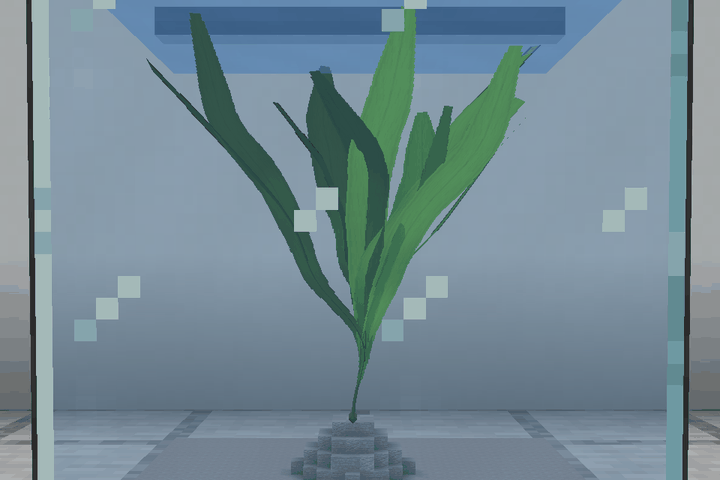

---
navigation:
  title: Java Fern
  icon: bettacraft:java_fern
  parent: plants/epiphytes.md
  position: 10
item_ids:
  - bettacraft:java_fern
---

# Java Fern

Java fern (*Microsorum pteropus*) from the streams of South-East Asia: long, firm fronds on a creeping rhizome.

## Profile

| | |
|---|---|
| Growth form | epiphyte (rhizome) |
| Grows on | stone and wood (also decoration) |
| Light | low |
| Full size | after about 12 days |
| Spreads | no |
| Cuttings per trim | 1 |

## Care

* Tie it to **stone or wood** (decoration too), never into the substrate.
* Content with little light; slow.

## Obtaining

* **Fishing** in jungles and rivers: 1.5 % per catch, instead of the fish.
* **Cuttings**: shears on a grown plant give 1 cutting per trim; breaking a rhizome piece divides it.
