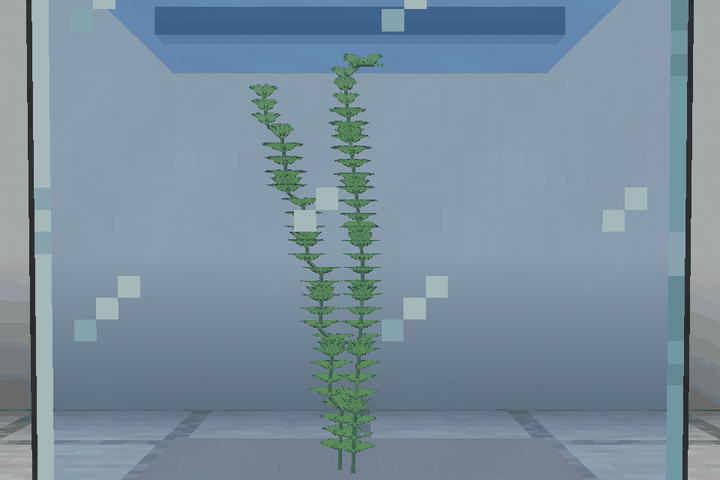

---
navigation:
  title: Limnophila Sessiliflora
  icon: bettacraft:limnophila_sessiliflora
  parent: plants/stem_plants.md
  position: 90
item_ids:
  - bettacraft:limnophila_sessiliflora
---

# Limnophila Sessiliflora

*Limnophila sessiliflora* from Southeast Asia: soft, feathery whorls of light green leaves.

## Profile

| | |
|---|---|
| Growth form | stem plant |
| Grows on | substrate (sand, gravel, dirt, the interior floor) |
| Light | medium |
| Full size | after about 2.5 days |
| Spreads | side shoots |
| Cuttings per trim | 3 |

## Care

* Fast and undemanding; medium light is enough.
* Takes up much waste.

## Obtaining

* **[Aquarium net](../equipment/tank_net.md)** in swamps: 0.38–0.46 % per swing (about 1 in 217–260 swings) (config `features.plantNetCatches`).
* **Fishing** in swamps: 0.19 % per catch (about 1 in 528 catches), instead of the fish.
* **Shears** on a wild plant in swamps: 100 % per cut (config `features.wildPlants`).
* **Cuttings**: shears on a grown plant give 3 cuttings per trim; it also spreads by itself (side shoots).

The biomes of biome mods count too ([biome tags](../settings.md)).
