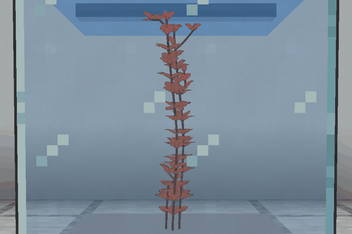

---
navigation:
  title: Ludwigia Repens
  icon: bettacraft:ludwigia_repens
  parent: plants/stem_plants.md
  position: 20
item_ids:
  - bettacraft:ludwigia_repens
---

# Ludwigia Repens

*Ludwigia repens* from North and Central America: a stem plant with round leaves, green to red.

## Profile

| | |
|---|---|
| Growth form | stem plant |
| Grows on | substrate (sand, gravel, dirt, the interior floor) |
| Light | medium |
| Full size | after about 3 days |
| Spreads | side shoots |
| Cuttings per trim | 3 |
| Colour | redder in strong light |

## Care

* Grows fast; medium light, redder in strong light.

## Obtaining

* **Fishing** in swamps: 0.83 % per catch (about 1 in 120 catches), instead of the fish.
* **Fishing** in mangrove swamps: 0.94 % per catch (about 1 in 106 catches), instead of the fish.
* **Glass bottle** filled with water in swamps: 0.85 % per bottle, along with the water.
* **Cuttings**: shears on a grown plant give 3 cuttings per trim; it also spreads by itself (side shoots).
