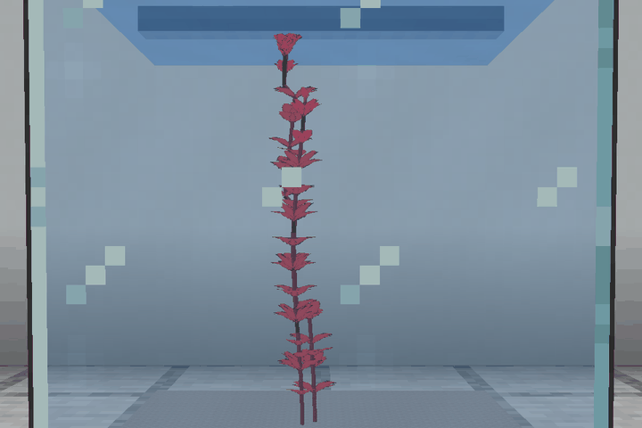

---
navigation:
  title: Ludwigia 'Super Red'
  icon: bettacraft:ludwigia_super_red
  parent: plants/stem_plants.md
  position: 40
item_ids:
  - bettacraft:ludwigia_super_red
---

# Ludwigia 'Super Red'

*Ludwigia palustris* "Super Red", a form bred for its colour: deep wine-red leaves.

## Profile

| | |
|---|---|
| Growth form | stem plant |
| Grows on | substrate (sand, gravel, dirt, the interior floor) |
| Light | strong |
| Full size | after about 3.5 days |
| Spreads | side shoots |
| Cuttings per trim | 3 |
| Colour | redder in strong light |
| CO2 | needed: without CO2 it grows at 40 % speed |

## Care

* Fast; strong light makes it the reddest.
* Grows well only with [CO2](../equipment/co2.md).

## Obtaining

* **Fishing** in swamps: 0.14 % per catch (about 1 in 734 catches), instead of the fish.
* **Cuttings**: shears on a grown plant give 3 cuttings per trim; it also spreads by itself (side shoots).

The biomes of biome mods count too ([biome tags](../settings.md)).
