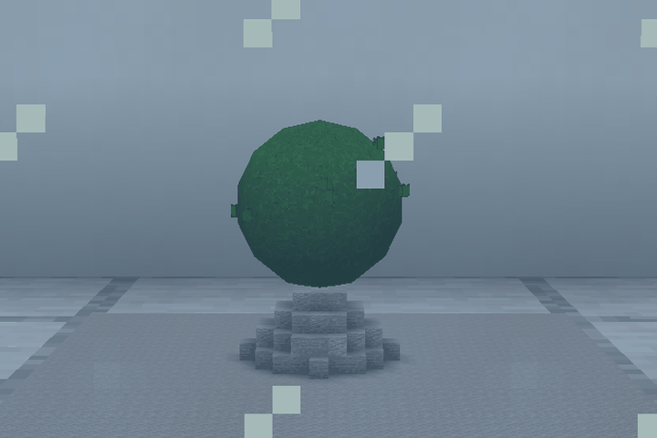

---
navigation:
  title: Marimo Ball
  icon: bettacraft:marimo
  parent: plants/epiphytes.md
  position: 74
item_ids:
  - bettacraft:marimo
---

# Marimo Ball

The Marimo ball (*Aegagropila linnaei*) from the cold lakes of Japan and Northern Europe: a velvety ball of green algae.

## Profile

| | |
|---|---|
| Growth form | ball of algae (lies loose) |
| Grows on | the floor or any solid block (it lies there and rolls with the current) |
| Light | low |
| Full size | after about 60 days |
| Spreads | no |
| Cuttings per trim | 2 |
| Temperature | also cool water (from 5 °C) |
| Rolls | with the current of filters and outlets (config `features.marimoRolling`) |

## Care

* Grows **extremely slowly** and lives practically forever; little light, cool water is fine.
* In the current of a [filter](../equipment/filters.md) or an outlet it **rolls** slowly over the floor (config `features.marimoRolling`); in still water it stays where it lies.

## Obtaining

* **[Aquarium net](../equipment/tank_net.md)** in rivers: 0.08–0.1 % per swing (about 1 in 1042–1250 swings) (config `features.plantNetCatches`).
* **Fishing** in rivers: 0.03 % per catch (about 1 in 3100 catches), instead of the fish.
* **Cuttings**: shears on a grown plant give 2 cuttings per trim.

The biomes of biome mods count too ([biome tags](../settings.md)).
