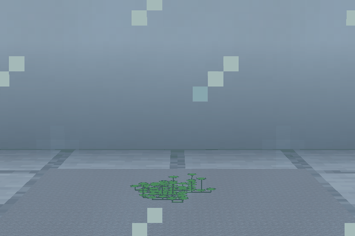

---
navigation:
  title: Marsilea (Water Clover)
  icon: bettacraft:marsilea_hirsuta
  parent: plants/runners.md
  position: 60
item_ids:
  - bettacraft:marsilea_hirsuta
---

# Marsilea (Water Clover)

Water clover (*Marsilea hirsuta*) from Australia: a fern with little four-leaved clovers on thin stalks.

## Profile

| | |
|---|---|
| Growth form | carpet |
| Grows on | substrate (sand, gravel, dirt, the interior floor) |
| Light | low |
| Full size | after about 6 days |
| Spreads | runners |
| Cuttings per trim | 2 |

## Care

* Content with **little light**; grows slowly.
* The easiest carpet for a tank without strong light.

## Obtaining

* **[Aquarium net](../equipment/tank_net.md)** in swamps: 0.31–0.37 % per swing (about 1 in 271–325 swings) (config `features.plantNetCatches`).
* **Fishing** in swamps: 0.13 % per catch (about 1 in 793 catches), instead of the fish.
* **Shears** on a wild plant in swamps: 100 % per cut (config `features.wildPlants`).
* **Cuttings**: shears on a grown plant give 2 cuttings per trim; it also spreads by itself (runners).

The biomes of biome mods count too ([biome tags](../settings.md)).
