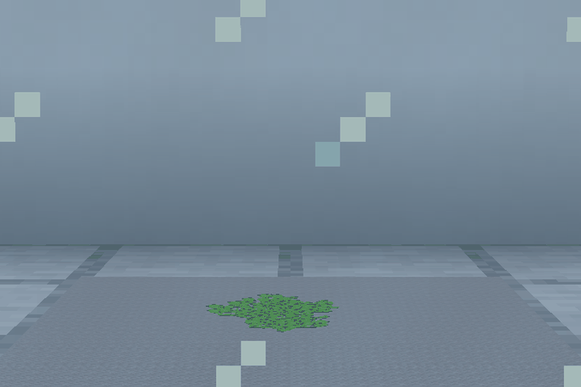

---
navigation:
  title: Monte Carlo
  icon: bettacraft:monte_carlo
  parent: plants/runners.md
  position: 20
item_ids:
  - bettacraft:monte_carlo
---

# Monte Carlo

Monte Carlo (*Micranthemum tweediei*) from Argentina: a carpet of tiny round leaves.

## Profile

| | |
|---|---|
| Growth form | carpet |
| Grows on | substrate (sand, gravel, dirt, the interior floor) |
| Light | strong |
| Full size | after about 3 days |
| Spreads | runners |
| Cuttings per trim | 2 |

## Care

* Covers the ground with runners; needs strong light.

## Obtaining

* **Wandering trader** (usual offers): 2 for 1 emerald.
* **Cuttings**: shears on a grown plant give 2 cuttings per trim; it also spreads by itself (runners).
