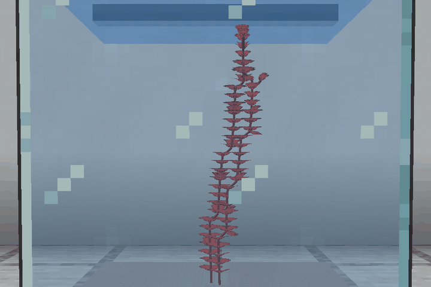

---
navigation:
  title: Myriophyllum 'Red'
  icon: bettacraft:myriophyllum_red
  parent: plants/stem_plants.md
  position: 100
item_ids:
  - bettacraft:myriophyllum_red
---

# Myriophyllum 'Red'

*Myriophyllum tuberculatum* "Red": feathery whorls in deep red.

## Profile

| | |
|---|---|
| Growth form | stem plant |
| Grows on | substrate (sand, gravel, dirt, the interior floor) |
| Light | strong |
| Full size | after about 3 days |
| Spreads | side shoots |
| Cuttings per trim | 3 |
| Colour | redder in strong light |
| CO2 | needed: without CO2 it grows at 40 % speed |
| Water chemistry | soft water: best up to pH 7 and 300 TDS, slower in hard water |

## Care

* Demanding: strong light, [CO2](../equipment/co2.md) and soft water ([water chemistry](../aquarium/water_chemistry.md)).
* Redder in strong light.

## Obtaining

* **[Aquarium net](../equipment/tank_net.md)** in swamps: 0.23–0.28 % per swing (about 1 in 361–433 swings) (config `features.plantNetCatches`).
* **Fishing** in swamps: 0.1 % per catch (about 1 in 979 catches), instead of the fish.
* **Cuttings**: shears on a grown plant give 3 cuttings per trim; it also spreads by itself (side shoots).

The biomes of biome mods count too ([biome tags](../settings.md)).
