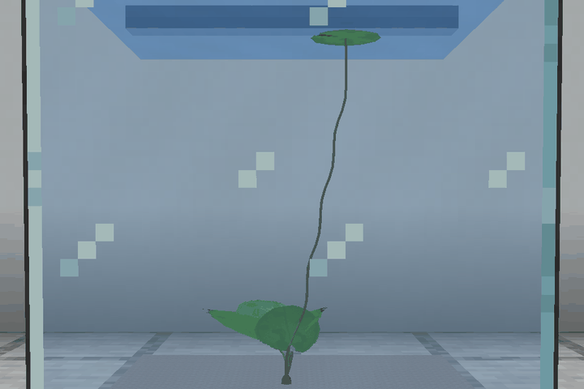

---
navigation:
  title: Green Tiger Lotus
  icon: bettacraft:nymphaea_lotus_green
  parent: plants/rosettes.md
  position: 51
item_ids:
  - bettacraft:nymphaea_lotus_green
---

# Green Tiger Lotus

The green tiger lotus (*Nymphaea lotus*) from tropical Africa: green leaves with brown spots.

## Profile

| | |
|---|---|
| Growth form | bulb with floating leaves |
| Grows on | substrate (sand, gravel, dirt, the interior floor) |
| Light | medium |
| Full size | after about 6 days |
| Spreads | no |
| Cuttings per trim | 1 |

## Care

* Medium light, like the [red tiger lotus](red_tiger_lotus.md).
* Grown up it sends floating leaves to the surface; they shade the tank.

## Obtaining

* **[Aquarium net](../equipment/tank_net.md)** in swamps: 0.12–0.14 % per swing (about 1 in 722–867 swings) (config `features.plantNetCatches`).
* **Fishing** in jungle water: 0.14 % per catch (about 1 in 730 catches), instead of the fish.
* **Cuttings**: shears on a grown plant give 1 cutting per trim.

The biomes of biome mods count too ([biome tags](../settings.md)).
