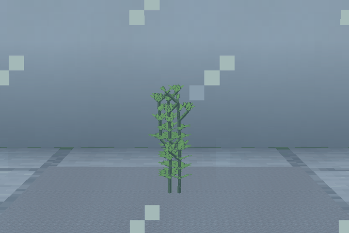

---
navigation:
  title: Pogostemon Helferi 'Downoi'
  icon: bettacraft:pogostemon_helferi
  parent: plants/stem_plants.md
  position: 80
item_ids:
  - bettacraft:pogostemon_helferi
---

# Pogostemon Helferi 'Downoi'

*Pogostemon helferi* "Downoi" from Thailand and Myanmar: a low bush of crinkled, light green leaves.

## Profile

| | |
|---|---|
| Growth form | stem plant |
| Grows on | substrate (sand, gravel, dirt, the interior floor) |
| Light | strong |
| Full size | after about 6 days |
| Spreads | side shoots |
| Cuttings per trim | 3 |
| CO2 | needed: without CO2 it grows at 40 % speed |

## Care

* Stays low: a plant for the front; forms side shoots.
* Strong light; grows well only with [CO2](../equipment/co2.md).

## Obtaining

* **[Aquarium net](../equipment/tank_net.md)** in rivers: 0.2–0.24 % per swing (about 1 in 417–500 swings) (config `features.plantNetCatches`).
* **Fishing** in rivers: 0.1 % per catch (about 1 in 1033 catches), instead of the fish.
* **Cuttings**: shears on a grown plant give 3 cuttings per trim; it also spreads by itself (side shoots).

The biomes of biome mods count too ([biome tags](../settings.md)).
