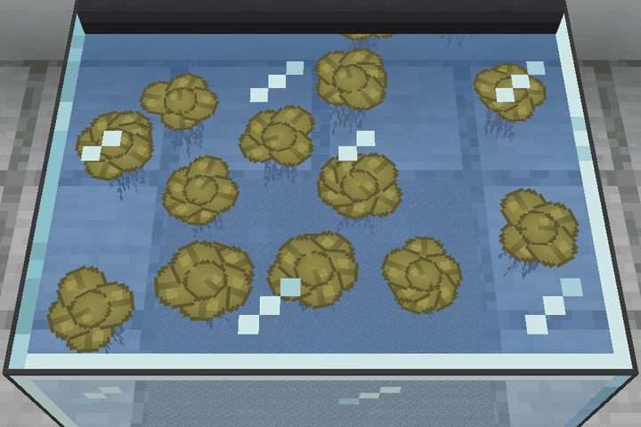

---
navigation:
  title: Red Root Floater
  icon: bettacraft:red_root_floater
  parent: plants/floating_plants.md
  position: 40
item_ids:
  - bettacraft:red_root_floater
---

# Red Root Floater

The red root floater (*Phyllanthus fluitans*) from South America: round leaves and red roots, red under strong light and green under weak light.

## Profile

| | |
|---|---|
| Growth form | floating plant |
| Leaf size | up to 4.8 cm |
| Growth | medium |
| Waste uptake | ×1.2 |
| Nest site | good |
| Roots | long |

## Care

* Slow; its colour shows how strong the light is.
* Rare: from fishing in mangrove swamps or the wandering trader.

## Obtaining

* **Fishing** in mangrove swamps: 0.9 % per catch (about 1 in 111 catches), instead of the fish.
* **Wandering trader** (rare offers): 2 for 3 emeralds.
* **Offshoots**: grows on a lit aquarium surface and forms offshoots; take some out with the aquarium net.
