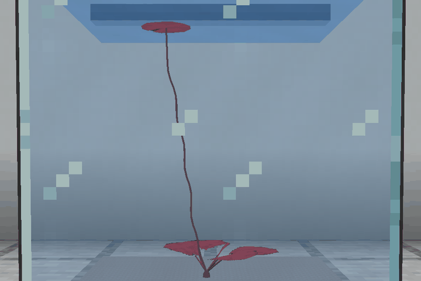

---
navigation:
  title: Red Tiger Lotus
  icon: bettacraft:red_tiger_lotus
  parent: plants/rosettes.md
  position: 50
item_ids:
  - bettacraft:red_tiger_lotus
---

# Red Tiger Lotus

The red tiger lotus (*Nymphaea zenkeri*) from West Africa: a bulb with mottled red leaves and floating leaves on long stalks.

## Profile

| | |
|---|---|
| Growth form | bulb with floating leaves |
| Grows on | substrate (sand, gravel, dirt, the interior floor) |
| Light | medium |
| Full size | after about 6 days |
| Spreads | no |
| Cuttings per trim | 1 |
| Colour | redder in strong light |

## Care

* In the substrate; medium light, redder in strong light.
* Its floating leaves shade the water below a little.

## Obtaining

* **[Aquarium net](../equipment/tank_net.md)** in swamps: 0.92–1.1 % per swing (about 1 in 90–108 swings) (config `features.plantNetCatches`).
* **[Aquarium net](../equipment/tank_net.md)** in jungle water: 0.98–1.2 % per swing (about 1 in 85–102 swings) (config `features.plantNetCatches`).
* **Fishing** in jungle water: 0.19 % per catch (about 1 in 540 catches), instead of the fish.
* **Fishing** in swamps: 0.17 % per catch (about 1 in 587 catches), instead of the fish.
* **Wandering trader** (rare offers): 1 for 4 emeralds.
* **Cuttings**: shears on a grown plant give 1 cutting per trim.

The biomes of biome mods count too ([biome tags](../settings.md)).
