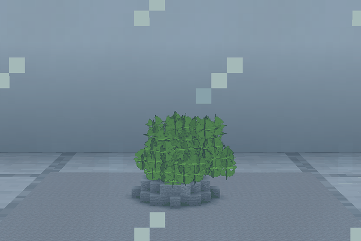

---
navigation:
  title: Riccia (Crystalwort)
  icon: bettacraft:riccia_fluitans
  parent: plants/epiphytes.md
  position: 73
item_ids:
  - bettacraft:riccia_fluitans
---

# Riccia (Crystalwort)

Crystalwort (*Riccia fluitans*): a liverwort of small, forked thalli; tied onto stone or wood it becomes a shining cushion, on the surface it floats.

## Profile

| | |
|---|---|
| Growth form | moss |
| Grows on | stone and wood (also decoration); or floating on the surface |
| Light | strong |
| Full size | after about 4 days |
| Spreads | no |
| Cuttings per trim | 2 |
| Floating | yes: use it on a tank from outside |

## Care

* **Tied** onto stone or wood in the interior (not on the floor), it needs **strong light**.
* **Floating**: use the same item on a tank from outside, it floats like a [floating plant](floating_plants.md) and males like to build their bubble nest in it.

## Obtaining

* **[Aquarium net](../equipment/tank_net.md)** in swamps: 0.23–0.28 % per swing (about 1 in 361–433 swings) (config `features.plantNetCatches`).
* **Fishing** in swamps: 0.13 % per catch (about 1 in 793 catches), instead of the fish.
* **Breaking wild floating plants** in swamps: 100 % per block (config `features.wildPlants`).
* **Shears** on a wild plant in rivers: 100 % per cut (config `features.wildPlants`).
* **Cuttings**: shears on a grown plant give 2 cuttings per trim.

The biomes of biome mods count too ([biome tags](../settings.md)).
