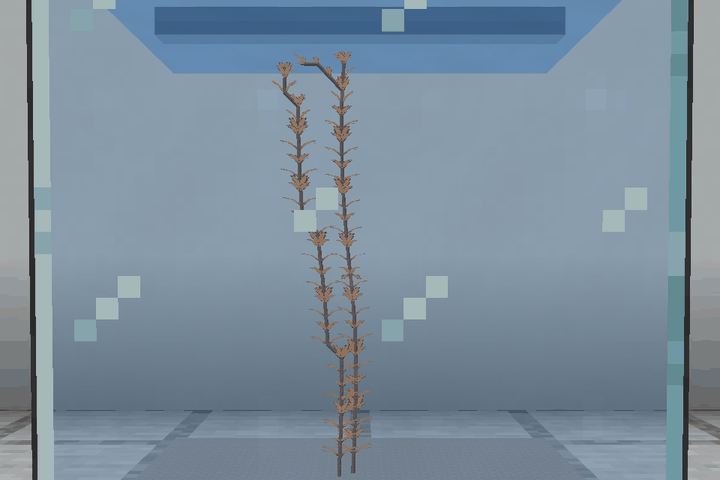

---
navigation:
  title: Rotala 'H'ra'
  icon: bettacraft:rotala_hra
  parent: plants/stem_plants.md
  position: 50
item_ids:
  - bettacraft:rotala_hra
---

# Rotala 'H'ra'

*Rotala rotundifolia* "H'ra" from Vietnam: narrow leaves that turn orange and pink in strong light.

## Profile

| | |
|---|---|
| Growth form | stem plant |
| Grows on | substrate (sand, gravel, dirt, the interior floor) |
| Light | strong |
| Full size | after about 3 days |
| Spreads | side shoots |
| Cuttings per trim | 3 |
| Colour | redder in strong light |
| CO2 | needed: without CO2 it grows at 40 % speed |

## Care

* Fast; strong light makes it redder.
* Grows well only with [CO2](../equipment/co2.md).

## Obtaining

* **[Aquarium net](../equipment/tank_net.md)** in swamps: 0.23–0.28 % per swing (about 1 in 361–433 swings) (config `features.plantNetCatches`).
* **Fishing** in swamps: 0.1 % per catch (about 1 in 979 catches), instead of the fish.
* **Cuttings**: shears on a grown plant give 3 cuttings per trim; it also spreads by itself (side shoots).

The biomes of biome mods count too ([biome tags](../settings.md)).
