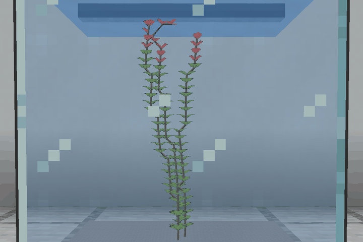

---
navigation:
  title: Rotala Rotundifolia
  icon: bettacraft:rotala_rotundifolia
  parent: plants/stem_plants.md
  position: 10
item_ids:
  - bettacraft:rotala_rotundifolia
---

# Rotala Rotundifolia

*Rotala rotundifolia* from South and East Asia: a stem plant with small round leaves and red tips in strong light.

## Profile

| | |
|---|---|
| Growth form | stem plant |
| Grows on | substrate (sand, gravel, dirt, the interior floor) |
| Light | strong |
| Full size | after about 2.5 days |
| Spreads | side shoots |
| Cuttings per trim | 3 |
| Colour | red tips in strong light |

## Care

* Grows fast up to the surface, then forms side shoots; trim it often.
* Needs strong light.

## Obtaining

* **Fishing** in swamps: 0.68 % per catch (about 1 in 147 catches), instead of the fish.
* **Fishing** in mangrove swamps: 0.94 % per catch (about 1 in 106 catches), instead of the fish.
* **Glass bottle** filled with water in swamps: 0.85 % per bottle, along with the water.
* **Cuttings**: shears on a grown plant give 3 cuttings per trim; it also spreads by itself (side shoots).

The biomes of biome mods count too ([biome tags](../settings.md)).
