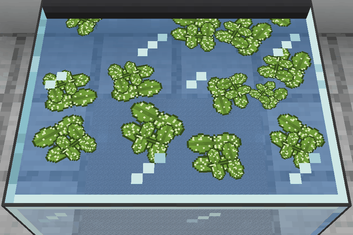

---
navigation:
  title: Salvinia
  icon: bettacraft:salvinia
  parent: plants/floating_plants.md
  position: 30
item_ids:
  - bettacraft:salvinia
---

# Salvinia

Salvinia (*Salvinia natans*), a floating fern from the still waters of Europe and Asia: small, paired, hairy leaves.

## Profile

| | |
|---|---|
| Growth form | floating plant |
| Leaf size | up to 5.3 cm |
| Growth | fast |
| Waste uptake | ×1.1 |
| Nest site | good |
| Roots | medium |

## Care

* Robust, medium growth; a good nest site.

## Obtaining

* **Fishing** in swamps: 1.4 % per catch (about 1 in 70 catches), instead of the fish.
* **Fishing** in mangrove swamps: 1.3 % per catch (about 1 in 80 catches), instead of the fish.
* **Wandering trader** (usual offers): 3 for 1 emerald.
* **Offshoots**: grows on a lit aquarium surface and forms offshoots; take some out with the aquarium net.

The biomes of biome mods count too ([biome tags](../settings.md)).
