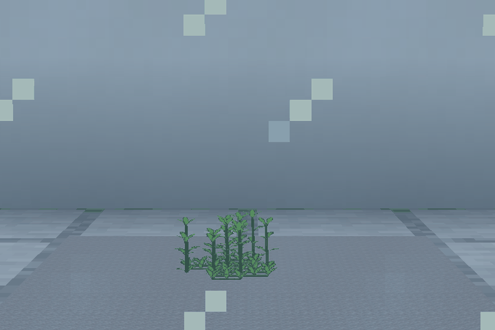

---
navigation:
  title: Staurogyne Repens
  icon: bettacraft:staurogyne_repens
  parent: plants/runners.md
  position: 50
item_ids:
  - bettacraft:staurogyne_repens
---

# Staurogyne Repens

*Staurogyne repens* from Brazil: short, bushy shoots with small leaves that stay low.

## Profile

| | |
|---|---|
| Growth form | carpet |
| Grows on | substrate (sand, gravel, dirt, the interior floor) |
| Light | medium |
| Full size | after about 4.5 days |
| Spreads | runners |
| Cuttings per trim | 2 |

## Care

* Undemanding: medium light, no CO2 needed.
* A low carpet that does not climb up the stones.

## Obtaining

* **[Aquarium net](../equipment/tank_net.md)** in jungle water: 0.27–0.32 % per swing (about 1 in 308–369 swings) (config `features.plantNetCatches`).
* **Fishing** in jungle water: 0.1 % per catch (about 1 in 973 catches), instead of the fish.
* **Cuttings**: shears on a grown plant give 2 cuttings per trim; it also spreads by itself (runners).

The biomes of biome mods count too ([biome tags](../settings.md)).
