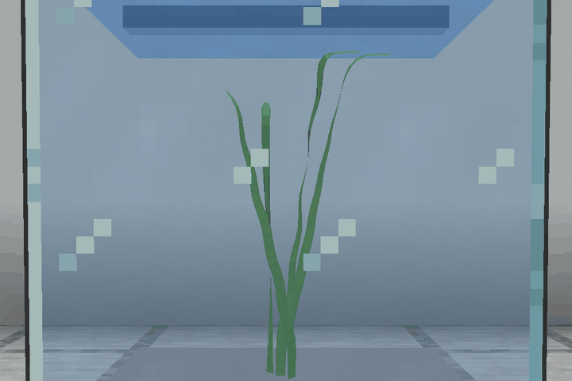

---
navigation:
  title: Vallisneria
  icon: bettacraft:vallisneria
  parent: plants/runners.md
  position: 10
item_ids:
  - bettacraft:vallisneria
---

# Vallisneria

Vallisneria (*Vallisneria spiralis*), eelgrass from warm waters worldwide: long ribbons up to the surface and along it.

## Profile

| | |
|---|---|
| Growth form | ribbons with runners |
| Grows on | substrate (sand, gravel, dirt, the interior floor) |
| Light | medium |
| Full size | after about 2.5 days |
| Spreads | runners |
| Cuttings per trim | 2 |

## Care

* Spreads with runners; medium light.
* New plants (from 1.14.2) keep their ribbons apart.

## Obtaining

* **[Aquarium net](../equipment/tank_net.md)** in rivers: 1.8–2.2 % per swing (about 1 in 46–56 swings) (config `features.plantNetCatches`).
* **Fishing** in rivers: 0.32 % per catch (about 1 in 310 catches), instead of the fish.
* **Wandering trader** (usual offers): 2 for 1 emerald.
* **Cuttings**: shears on a grown plant give 2 cuttings per trim; it also spreads by itself (runners).

The biomes of biome mods count too ([biome tags](../settings.md)).
