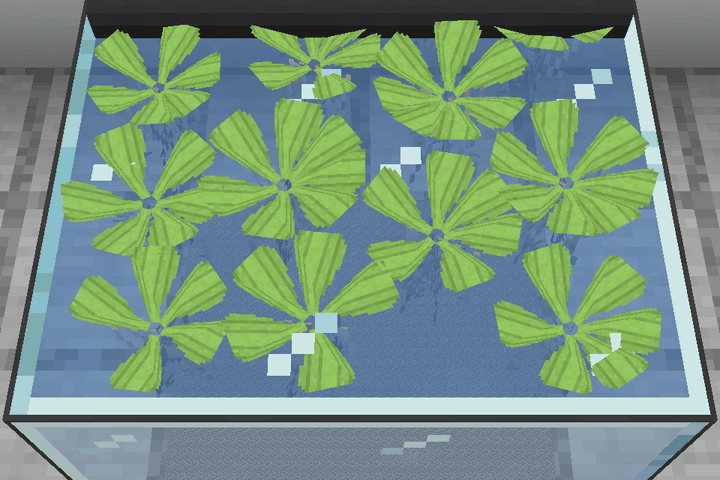

---
navigation:
  title: Water Lettuce
  icon: bettacraft:water_lettuce
  parent: plants/floating_plants.md
  position: 50
item_ids:
  - bettacraft:water_lettuce
---

# Water Lettuce

Water lettuce (*Pistia stratiotes*) from the tropics: rosettes of velvety leaves standing up like a cup, with long feathery roots.

## Profile

| | |
|---|---|
| Growth form | floating plant |
| Leaf size | up to 7.2 cm |
| Growth | medium |
| Waste uptake | ×1.5 |
| Nest site | good |
| Roots | long |

## Care

* Takes up much waste; its long roots are a hiding place for fry.
* A good nest site.

## Obtaining

* **Fishing** in swamps: 0.57 % per catch (about 1 in 175 catches), instead of the fish.
* **Fishing** in mangrove swamps: 0.6 % per catch (about 1 in 167 catches), instead of the fish.
* **Breaking wild floating plants** in jungle water: 100 % per block (config `features.floatingPlants.wildPlants`).
* **Breaking wild floating plants** in mangrove swamps: 100 % per block (config `features.floatingPlants.wildPlants`).
* **Offshoots**: grows on a lit aquarium surface and forms offshoots; take some out with the aquarium net.

The biomes of biome mods count too ([biome tags](../settings.md)).
