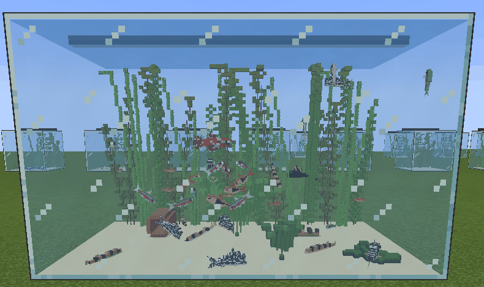

---
navigation:
  title: Reef tanks
  icon: bettacraft:sea_water_bucket
  parent: index.md
  position: 67
---

# Reef tanks (salt water)

A tank becomes a **reef tank** when you fill it with **sea water**: an empty bucket filled in an ocean or at a beach, or
water salted with **sea salt**. Salt water is clearer and bluer, and it is home to its own animals: **clownfish** in their
**anemone**, **tangs**, **gobies**, **damselfish**, **cleaner shrimp**, **hermit crabs** and **turbo snails**, and the
**corals** that grow on reef rock in the tank interior.

* [Salt water](saltwater/water.md): sea water, sea salt, mixing, brackish water, what lives in which water, calcium and nitrate.
* [Reef technique](saltwater/technique.md): protein skimmer, flow pump, actinic light, reef rock and live rock.
* [Corals](saltwater/corals.md): soft and stony corals and the anemone: light, flow, calcium, frags.
* [Reef animals](saltwater/reef_animals.md): the fish and the small animals of the reef, clownfish breeding, where to get them.

## In short

* **Salinity** is shown in ‰ (grams of salt per litre): fresh water 0, brackish 2 to 20, sea water 35.
* Freshwater animals (bettas, the tankmates, shrimp, most snails) **die in salt water**, reef animals **die in fresh
  water**; the tank refuses to take an animal whose water would kill it. Nerite snails and the livebearers tolerate
  brackish water.
* Evaporation leaves the salt behind: **top up a reef tank with fresh water**, do water changes with sea water.
* Existing tanks are freshwater tanks: nothing changes for them until salt goes in.
