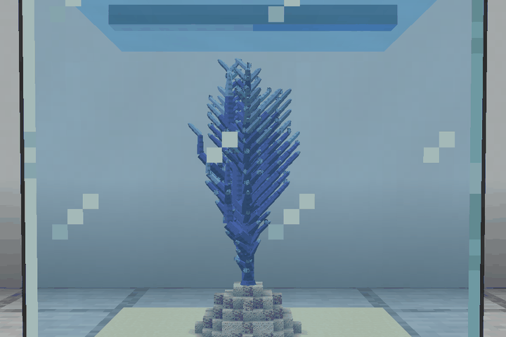

---
navigation:
  title: Acropora
  icon: bettacraft:acropora
  parent: saltwater/corals.md
  position: 70
item_ids:
  - bettacraft:acropora
  - bettacraft:wild_acropora
---

# Acropora

*Acropora*, the staghorn and table corals that build the reefs of the Indo-Pacific: a stony coral (SPS) of fine branches, blue to violet.

## Profile

| | |
|---|---|
| Growth form | branches (stony coral) |
| Grows on | reef rock, live rock |
| Light | strong |
| Flow | strong |
| Calcium | builds a skeleton, uses calcium |
| Water | sea water |
| Full size | after about 14 days |
| Spreads | no |
| Cuttings per trim | 1 |

## Care

* The most demanding coral: **strong light, strong flow, calcium and very clean water**.
* In poor conditions it turns pale or bleaches first.

## Obtaining

* **Shears** on a wild coral colony in warm oceans (coral reefs): 100 % per cut (config `features.wildCorals`).
* **Frags**: shears on a grown coral give 1 cutting per trim.

Crafting:

<RecipesFor id="bettacraft:acropora" />
