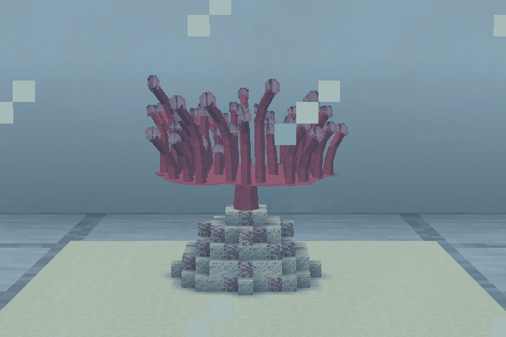

---
navigation:
  title: Bubble Tip Anemone
  icon: bettacraft:bubble_tip_anemone
  parent: saltwater/corals.md
  position: 80
item_ids:
  - bettacraft:bubble_tip_anemone
---

# Bubble Tip Anemone

The bubble tip anemone (*Entacmaea quadricolor*) from the Indo-Pacific: a sea anemone with bubble-tipped tentacles on a sticky foot, the home of the clownfish.

## Profile

| | |
|---|---|
| Growth form | anemone |
| Grows on | reef rock, live rock |
| Light | medium |
| Flow | medium |
| Calcium | not needed (soft coral) |
| Water | sea water |
| Full size | after about 6 days |
| Spreads | no |
| Cuttings per trim | 1 |

## Care

* One pair of [clownfish](ocellaris_clownfish.md) moves into each anemone and spawns at its foot.
* Medium light and flow, no calcium.

## Obtaining

* **[Aquarium net](../equipment/tank_net.md)** in warm oceans (coral reefs): 0.75–0.9 % per swing.
* **Wandering trader** (usual offers): 2 for 4 emeralds; one of 4 in this offer.
* **Frags**: shears on a grown coral give 1 cutting per trim.
