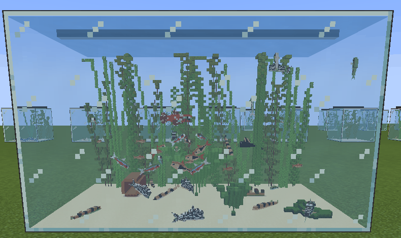
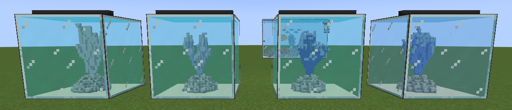

---
navigation:
  title: Corals
  icon: bettacraft:acropora
  parent: saltwater.md
  position: 30
---

# Corals

Corals grow in the [tank interior](../interior.md) like the aquarium plants, but only in **salt water** and only on
**reef rock**, live rock or coral blocks. Step into the tank and use the frag on the top or the side of a rock. A coral
grows stage by stage over the days when the conditions are right:

* **Salt water** (30–38 ‰ full speed, 25–42 ‰ half), **23–29 °C** (21–31 half).
* **Light** for its need, from a tank light; actinic + white is best (see [Reef technique](technique.md)).
* **Flow** for its need (flow pumps); still water a tenth of the speed.
* Stony corals: **calcium** (full from 380 mg/L, nothing below 250; each growth stage uses some) and **clean water**
  (little nitrate).

## Species

| | Coral | Light | Flow | Calcium | Full size |
|---|---|---|---|---|---|
| <ItemImage id="bettacraft:zoanthus" /> | [Zoanthids](zoanthus.md) | medium | gentle | no | about 5 days |
| <ItemImage id="bettacraft:green_star_polyps" /> | [Green Star Polyps](green_star_polyps.md) | medium | medium | no | about 4 days |
| <ItemImage id="bettacraft:mushroom_coral" /> | [Mushroom Coral](mushroom_coral.md) | low | gentle | no | about 8 days |
| <ItemImage id="bettacraft:leather_coral" /> | [Leather Coral](leather_coral.md) | medium | medium | no | about 10 days |
| <ItemImage id="bettacraft:hammer_coral" /> | [Hammer Coral](hammer_coral.md) | medium | medium | yes | about 12 days |
| <ItemImage id="bettacraft:lobophyllia" /> | [Lobophyllia](lobophyllia.md) | medium | gentle | yes | about 15 days |
| <ItemImage id="bettacraft:acropora" /> | [Acropora](acropora.md) | strong | strong | yes | about 14 days |
| <ItemImage id="bettacraft:bubble_tip_anemone" /> | [Bubble Tip Anemone](bubble_tip_anemone.md) | medium | medium | no | about 6 days |

## Shape and movement

Every coral has its own shape that moves in the water, inside and in the miniature: **zoanthids** stand on columns over
a thin mat, **green star polyps** cover the rock with a purple mat and green stars; both **close for a moment when a
fish swims by** (or you swim up to them inside). **Mushroom corals** slowly lift and lower their discs, the **leather
coral** has a rigid trunk and a cap whose polyp lawn waves, **Acropora** and **Lobophyllia** are rigid with small
waving polyps, the **hammer coral** sways and pulses with its hammer-tipped tentacles and the **bubble tip anemone**
with its tentacles. Minecraft's corals and coral fans sway a little in the miniature too.

## Colours

A coral shows how it is doing: in good conditions it has its colours, under **actinic light** it glows; when the conditions
are poor it turns **pale**, and in the wrong water, too warm or too cold or in the dark it **bleaches** white (and stops
growing). The colour follows over about two days.

## Frags and sources

* **Shears** on a coral cut frags off it (polyp mats and branches give several); in the interior and from outside through
  the glass like the aquarium plants.
* **Vanilla corals** crafted with reef rock give two frags: tube coral → green star polyps, brain coral → Lobophyllia,
  bubble coral → hammer coral, fire coral → Acropora, horn coral → leather coral.
* The **wandering trader** sells zoanthids, mushrooms, star polyps and the anemone; the [net](reef_animals.md) on a warm
  reef sometimes brings up a frag.
* Vanilla coral blocks, corals and fans also live in the tank interior. With the config `saltwater.vanillaCoralsNeedSalt`
  they die in fresh water like on land (off by default, so decorated freshwater tanks stay as they are).
