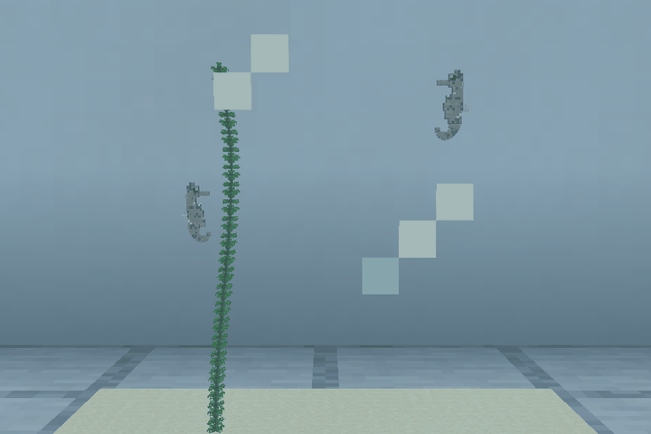

---
navigation:
  title: Dwarf Seahorse
  icon: bettacraft:dwarf_seahorse_bucket
  parent: saltwater/seahorses.md
  position: 20
item_ids:
  - bettacraft:dwarf_seahorse_bucket
  - bettacraft:dwarf_seahorse_spawn_egg
---

# Dwarf Seahorse

The dwarf seahorse (*Hippocampus zosterae*) from the seagrass meadows of Florida, the Bahamas and the Gulf of Mexico: one of the smallest seahorses, only 2–3 cm.

## Profile

| | |
|---|---|
| Group | Seahorses |
| Scientific name | *Hippocampus zosterae* |
| Size in the game | about 2.5 cm (0.22 blocks) |
| Temperature | 21–28 °C |
| Breeding temperature | 24–27 °C |
| Water | sea water, also strong brackish water, sensitive |
| Water chemistry | pH 7.8–8.6 |
| Shoal | alone or as a pair |
| Swims | in the lower water |
| Stocking | counts as 0.3 fish |
| Breeding | Brood pouch: the male carries the eggs, 3–10 young |

## Care

* Fits small tanks (counts as 0.3).
* Like the lined seahorse: hitching posts, low flow, live food twice a day.
* Breeds at 24–27 °C; the fry eat artemia nauplii from the first day.

## Obtaining

* **[Aquarium net](../equipment/tank_net.md)** in warm oceans (coral reefs): 0.83–0.99 % per swing (about 1 in 101–120 swings) (config `features.seahorses`).
* **Wild** in warm oceans (coral reefs), in groups of 1–1 (spawn weight 2) (config `features.seahorses`).
* **Wandering trader** (rare offers): 2 for 5 emeralds; one of 3 in this offer (config `features.seahorses`).
* **[Breeding](seahorses.md)**: Brood pouch: the male carries the eggs.

The biomes of biome mods count too ([biome tags](../settings.md)).
