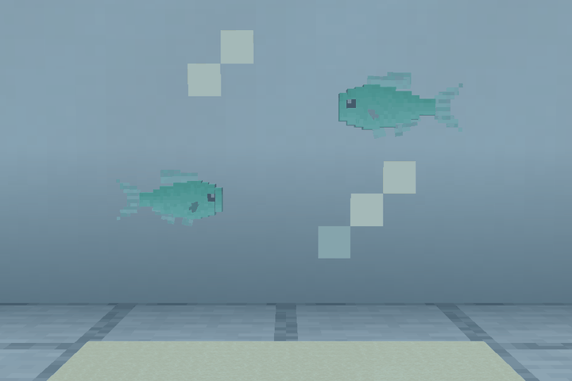

---
navigation:
  title: Green Chromis
  icon: bettacraft:green_chromis_bucket
  parent: saltwater/reef_animals.md
  position: 40
item_ids:
  - bettacraft:green_chromis_bucket
  - bettacraft:green_chromis_spawn_egg
---

# Green Chromis

The blue-green chromis (*Chromis viridis*) from the Indo-Pacific: small, shimmering green-blue damselfish that hover in shoals above branching corals.

## Profile

| | |
|---|---|
| Group | Damselfish |
| Scientific name | *Chromis viridis* |
| Size in the game | about 4.5 cm (0.38 blocks) |
| Temperature | 24–28 °C |
| Water | sea water, normal |
| Shoal | from 5 fish |
| Swims | in the middle |
| Stocking | counts as 0.5 fish |
| Breeding | Does not breed in a tank |

## Care

* Keep a **shoal of five or more**.
* Fast and busy: not for a seahorse tank.
* It does not breed in a tank.

## Obtaining

* **[Aquarium net](../equipment/tank_net.md)** in warm oceans (coral reefs): 2.9–3.5 % per swing (about 1 in 29–34 swings), 1–4 at a time.
* **[Aquarium net](../equipment/tank_net.md)** in lukewarm oceans: 3.8–4.5 % per swing (about 1 in 22–27 swings), 1–4 at a time.
* **Wild** in warm oceans (coral reefs), in groups of 3–5 (spawn weight 7) (config `features.wildFish`).
* **Wild** in lukewarm oceans, in groups of 3–5 (spawn weight 5) (config `features.wildFish`).
* **Wandering trader** (usual offers): 6 for 4 emeralds; one of 4 in this offer.
