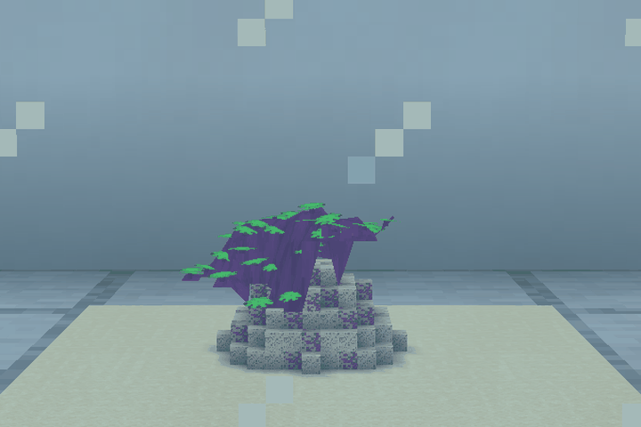

---
navigation:
  title: Green Star Polyps
  icon: bettacraft:green_star_polyps
  parent: saltwater/corals.md
  position: 20
item_ids:
  - bettacraft:green_star_polyps
  - bettacraft:wild_green_star_polyps
---

# Green Star Polyps

Green star polyps (*Pachyclavularia violacea*) from the Indo-Pacific: a purple mat that covers the rock, with green star-shaped polyps.

## Profile

| | |
|---|---|
| Growth form | polyp mat (soft coral) |
| Grows on | reef rock, live rock |
| Light | medium |
| Flow | medium |
| Calcium | not needed (soft coral) |
| Water | sea water |
| Full size | after about 4 days |
| Spreads | over the rock |
| Cuttings per trim | 2 |

## Care

* Easy and fast: medium light and flow, no calcium.
* Spreads fast over the rock; trim it back with shears.

## Obtaining

* **[Aquarium net](../equipment/tank_net.md)** in warm oceans (coral reefs): 0.6–0.72 % per swing (about 1 in 139–167 swings).
* **Shears** on a wild coral colony in warm oceans (coral reefs): 100 % per cut (config `features.wildCorals`).
* **Wandering trader** (usual offers): 2 for 4 emeralds; one of 4 in this offer.
* **Frags**: shears on a grown coral give 2 cuttings per trim; it also spreads by itself (over the rock).

Crafting:

<RecipesFor id="bettacraft:green_star_polyps" />
