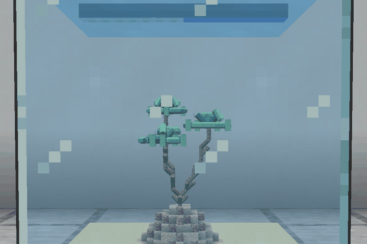

---
navigation:
  title: Hammer Coral
  icon: bettacraft:hammer_coral
  parent: saltwater/corals.md
  position: 50
item_ids:
  - bettacraft:hammer_coral
---

# Hammer Coral

The hammer coral (*Euphyllia ancora*) from the Indo-Pacific: a stony coral (LPS) whose long tentacles end in small hammers; they sway and pulse in the water.

## Profile

| | |
|---|---|
| Growth form | branches (stony coral) |
| Grows on | reef rock, live rock |
| Light | medium |
| Flow | medium |
| Calcium | builds a skeleton, uses calcium |
| Water | sea water |
| Full size | after about 12 days |
| Spreads | no |
| Cuttings per trim | 1 |

## Care

* Builds a skeleton: needs **calcium** and clean water.
* Medium light and flow.

## Obtaining

* **Frags**: shears on a grown coral give 1 cutting per trim.

Crafting:

<RecipesFor id="bettacraft:hammer_coral" />
