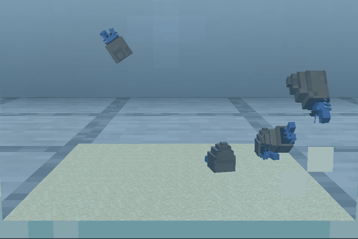

---
navigation:
  title: Blue-Leg Hermit Crab
  icon: bettacraft:fish_bag
  parent: saltwater/reef_invertebrates.md
  position: 20
---

# Blue-Leg Hermit Crab

The blue-leg hermit crab (*Clibanarius tricolor*) from the Caribbean: a small crab with blue legs in a borrowed snail shell, part of the clean-up crew of a reef tank.

## Profile

| | |
|---|---|
| Group | Hermit crabs |
| Size in the game | about 2.5 cm (0.2 blocks) |
| Temperature | 22–28 °C |
| Water | sea water, also strong brackish water, normal |
| Breeding | does not breed in a tank |
| Algae | grazes 0.8 glass faces a day |
| Climbs the glass | yes |
| Stocking | 50 count as one fish |

## Care

* Grazes algae and eats leftovers.
* Hardy: also in strong brackish water from 20 ‰; also caught at beaches.
* It does not breed in a tank.

## Obtaining

* **[Aquarium net](../equipment/tank_net.md)** at beaches: 4.5–5.4 % per swing, 1–2 at a time.
* **[Aquarium net](../equipment/tank_net.md)** in warm oceans (coral reefs): 9.6–12 % per swing, 1–2 at a time.
* **[Aquarium net](../equipment/tank_net.md)** in lukewarm oceans: 13–16 % per swing, 1–2 at a time.
* **Wild** at beaches, in groups of 2–5 (spawn weight 1) (config `features.wildCritters`).
* **Wild** in warm oceans (coral reefs), in groups of 2–5 (spawn weight 2) (config `features.wildCritters`).
* **Wild** in lukewarm oceans, in groups of 2–5 (spawn weight 3) (config `features.wildCritters`).
* **Wandering trader** (rare offers): 3 for 5 emeralds; one of 2 in this offer.
