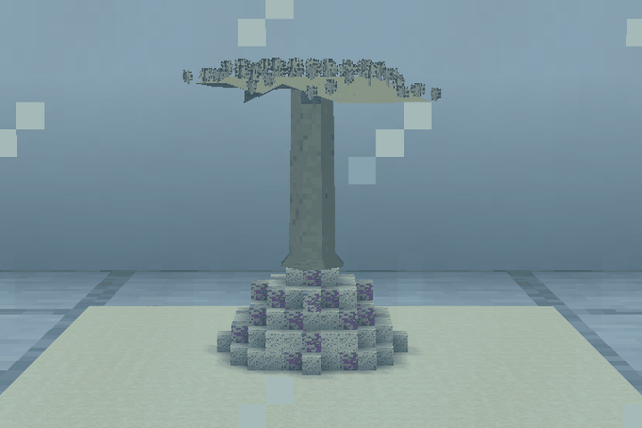

---
navigation:
  title: Leather Coral
  icon: bettacraft:leather_coral
  parent: saltwater/corals.md
  position: 40
item_ids:
  - bettacraft:leather_coral
  - bettacraft:wild_leather_coral
---

# Leather Coral

The toadstool leather coral (*Sarcophyton* sp.) from the Indo-Pacific: a firm trunk with a cap covered in a waving lawn of polyps.

## Profile

| | |
|---|---|
| Growth form | toadstool (soft coral) |
| Grows on | reef rock, live rock |
| Light | medium |
| Flow | medium |
| Calcium | not needed (soft coral) |
| Water | sea water |
| Full size | after about 10 days |
| Spreads | no |
| Cuttings per trim | 1 |

## Care

* Soft coral: medium light and flow, no calcium.
* Propagate it with frags (shears).

## Obtaining

* **[Aquarium net](../equipment/tank_net.md)** in warm oceans (coral reefs): 0.24–0.29 % per swing (about 1 in 347–417 swings).
* **Shears** on a wild coral colony in warm oceans (coral reefs): 100 % per cut (config `features.wildCorals`).
* **Frags**: shears on a grown coral give 1 cutting per trim.

Crafting:

<RecipesFor id="bettacraft:leather_coral" />
