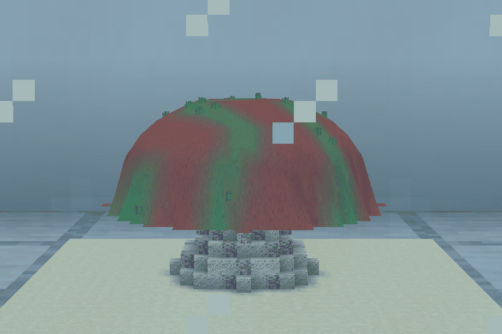

---
navigation:
  title: Lobophyllia
  icon: bettacraft:lobophyllia
  parent: saltwater/corals.md
  position: 60
item_ids:
  - bettacraft:lobophyllia
  - bettacraft:wild_lobophyllia
---

# Lobophyllia

*Lobophyllia* (lobed brain coral) from the Indo-Pacific: a stony coral (LPS) that grows into a fleshy dome of red and green lobes.

## Profile

| | |
|---|---|
| Growth form | dome (stony coral) |
| Grows on | reef rock, live rock |
| Light | medium |
| Flow | gentle |
| Calcium | builds a skeleton, uses calcium |
| Water | sea water |
| Full size | after about 15 days |
| Spreads | no |
| Cuttings per trim | 1 |

## Care

* Builds a skeleton: needs **calcium**.
* Medium light, gentle flow.

## Obtaining

* **[Aquarium net](../equipment/tank_net.md)** in warm oceans (coral reefs): 0.12–0.14 % per swing (about 1 in 694–833 swings).
* **Shears** on a wild coral colony in warm oceans (coral reefs): 100 % per cut (config `features.wildCorals`).
* **Frags**: shears on a grown coral give 1 cutting per trim.

Crafting:

<RecipesFor id="bettacraft:lobophyllia" />
