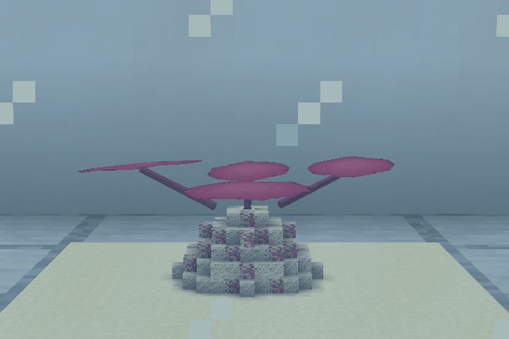

---
navigation:
  title: Mushroom Coral
  icon: bettacraft:mushroom_coral
  parent: saltwater/corals.md
  position: 30
item_ids:
  - bettacraft:mushroom_coral
  - bettacraft:wild_mushroom_coral
---

# Mushroom Coral

Mushroom corals (disc anemones, *Discosoma* sp.) from the Indo-Pacific and the Caribbean: flat red-pink discs that slowly lift and lower.

## Profile

| | |
|---|---|
| Growth form | discs (soft coral) |
| Grows on | reef rock, live rock |
| Light | low |
| Flow | gentle |
| Calcium | not needed (soft coral) |
| Water | sea water |
| Full size | after about 8 days |
| Spreads | over the rock |
| Cuttings per trim | 1 |

## Care

* The most modest coral: little light, gentle flow.
* New discs appear next to the old ones.

## Obtaining

* **[Aquarium net](../equipment/tank_net.md)** in warm oceans (coral reefs): 0.6–0.72 % per swing (about 1 in 139–167 swings).
* **Shears** on a wild coral colony in warm oceans (coral reefs): 100 % per cut (config `features.wildCorals`).
* **Wandering trader** (usual offers): 2 for 4 emeralds; one of 4 in this offer.
* **Frags**: shears on a grown coral give 1 cutting per trim; it also spreads by itself (over the rock).

The biomes of biome mods count too ([biome tags](../settings.md)).
