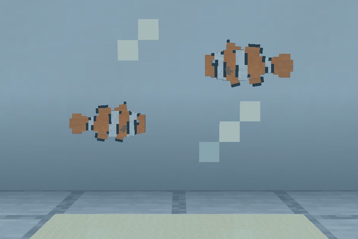

---
navigation:
  title: Ocellaris Clownfish
  icon: bettacraft:ocellaris_clownfish_bucket
  parent: saltwater/reef_animals.md
  position: 10
item_ids:
  - bettacraft:ocellaris_clownfish_bucket
  - bettacraft:ocellaris_clownfish_spawn_egg
---

# Ocellaris Clownfish

The false percula clownfish (*Amphiprion ocellaris*) from the coral reefs of the eastern Indian Ocean and the western Pacific: orange with three white bands, or black with white bands ("Darwin"). A pair lives in a sea anemone, protected by its slime from the stinging tentacles.

## Profile

| | |
|---|---|
| Group | Clownfish |
| Scientific name | *Amphiprion ocellaris* |
| Size in the game | about 5.5 cm (0.45 blocks) |
| Temperature | 24–28 °C |
| Breeding temperature | 25–28 °C |
| Water | sea water, normal |
| Shoal | alone or as a pair |
| Swims | in the middle |
| Stocking | counts as 1 fish |
| Breeding | Spawns at its anemone, the male guards, 15–40 young |
| Special | 2 colour varieties |

## Care

* Give every pair a **bubble tip anemone** (see [Corals](corals.md)): adults without an anemone of their own are chased off.
* At 25–28 °C a fit pair spawns at the **foot of the anemone**; the male guards the eggs, the larvae hatch after a day and a half and eat [fry powder](../tankmates/breeding.md).
* Without an anemone clownfish live well, but they do not breed.

## Obtaining

* **[Aquarium net](../equipment/tank_net.md)** in warm oceans (coral reefs): 2.5–3 % per swing.
* **Wild** in warm oceans (coral reefs), in groups of 1–1 (spawn weight 6) (config `features.wildFish`).
* **Wandering trader** (usual offers): 2 for 4 emeralds; one of 4 in this offer.
* **[Breeding](reef_animals.md)**: Spawns at its anemone, the male guards.
