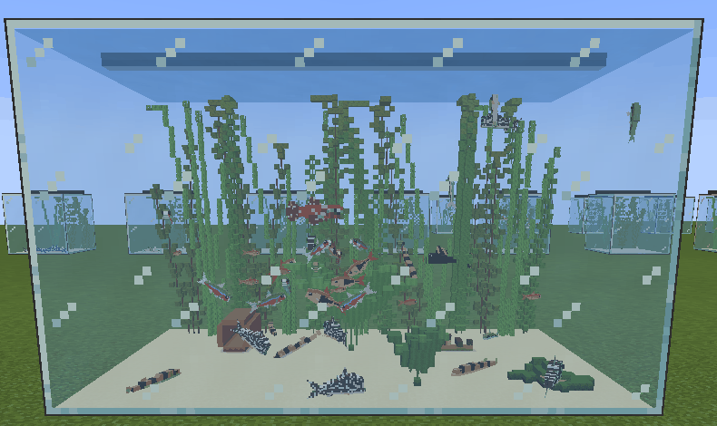

---
navigation:
  title: Reef animals
  icon: bettacraft:ocellaris_clownfish_bucket
  parent: saltwater.md
  position: 4
item_ids:
  - bettacraft:ocellaris_clownfish_bucket
  - bettacraft:yellow_tang_bucket
  - bettacraft:yellow_watchman_goby_bucket
  - bettacraft:green_chromis_bucket
  - bettacraft:yellowtail_damsel_bucket
  - bettacraft:ocellaris_clownfish_spawn_egg
  - bettacraft:yellow_tang_spawn_egg
  - bettacraft:yellow_watchman_goby_spawn_egg
  - bettacraft:green_chromis_spawn_egg
  - bettacraft:yellowtail_damsel_spawn_egg
---

# Reef animals

| Animal | ‰ | °C | Group | Stocking | Notes |
|---|---|---|---|---|---|
| Ocellaris Clownfish (*Amphiprion ocellaris*) | 28–40 | 24–28 | pair | 1 | lives in its anemone, breeds there; orange or black (Darwin) |
| Yellow Tang (*Zebrasoma flavescens*) | 28–40 | 24–28 | alone | 2.5 | grazes algae, needs clean water and room |
| Yellow Watchman Goby (*Cryptocentrus cinctus*) | 28–40 | 22–28 | alone | 0.6 | sits on the bottom |
| Green Chromis (*Chromis viridis*) | 28–40 | 24–28 | 5+ | 0.5 | a shoal above the corals |
| Yellowtail Damsel (*Chrysiptera parasema*) | 20–42 | 23–28 | alone | 0.45 | hardy, a good first fish |
| Pacific Cleaner Shrimp (*Lysmata amboinensis*) | 28–40 | 23–28 | – | shrimp | the fish heal half again as fast |
| Blue-Leg Hermit Crab (*Clibanarius tricolor*) | 20–42 | 22–28 | – | snail | grazes algae, eats leftovers |
| Mexican Turbo Snail (*Turbo fluctuosa*) | 28–40 | 22–28 | – | snail | the best algae grazer of the reef |

The reef fish are fish like the [tankmates](../tankmates.md) (bucket, fish bag, menu, health), the shrimp, crabs and
snails [small animals](../invertebrates.md) (fish bag, the small animals page of the menu). None of them goes into fresh
water, and none of the freshwater animals into a reef tank.

## Clownfish and their anemone

Clownfish live in a **bubble tip anemone** (see [Corals](corals.md)): an adult pair moves into each anemone, the young join
them; adults without an anemone of their own are chased off. At 25–28 °C a fit pair spawns at the **foot of the anemone**,
the male guards the orange eggs, and after a day and a half the larvae hatch; feed the fry [fry powder](../tankmates/breeding.md).
Without an anemone clownfish live well but do not breed. The other reef fish and the reef shrimp, crabs and snails do not
breed in a tank.

## Where to get them

* The **aquarium net** in a **warm ocean** (the coral reefs): clownfish, yellow tangs, gobies, chromis, damsels, cleaner
  shrimp, hermit crabs, turbo snails and now and then a coral frag; in a **lukewarm ocean** gobies, chromis, damsels,
  hermit crabs and turbo snails; at a **beach** hermit crabs among the nerites. Empty fish bags hold the catch
  (`saltwater.reefNetFishShare`: share of fish).
* The **wandering trader**: sea salt, a reef fish (clownfish pair, goby, chromis shoal, damsel), coral frags; rarely a
  yellow tang, a cleaner shrimp or hermit crabs, or live rock.
