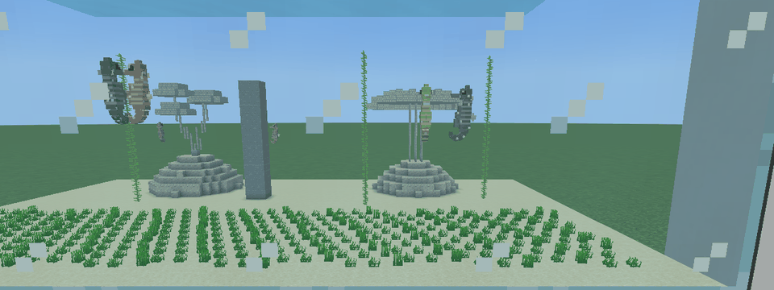
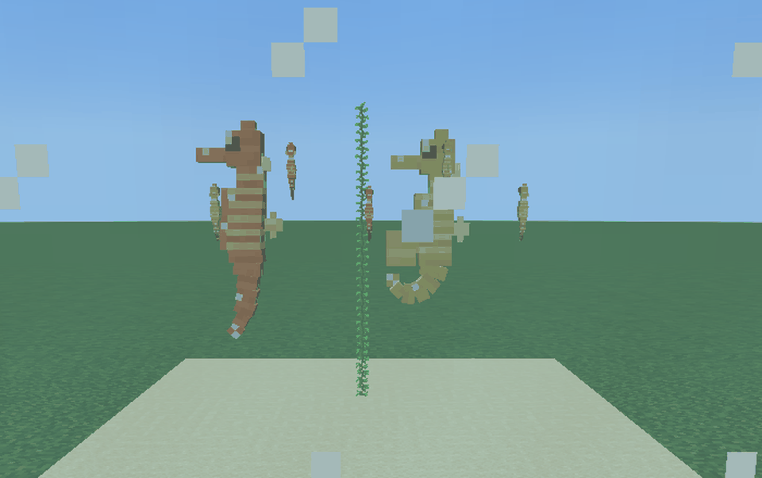

---
navigation:
  title: Seahorses
  icon: bettacraft:lined_seahorse_bucket
  parent: saltwater.md
  position: 60
---

# Seahorses

Seahorses are fish of their own kind: they swim slowly and **upright**, steer with the small fin on their back and spend
most of the day **holding on to something with their tail**. In a Bettacraft tank they need a quiet reef tank of their own
rather than a busy community tank.

## Species

| Species | °C | Shoal | Water | Breeding |
|---|---|---|---|---|
| <ItemImage id="bettacraft:lined_seahorse_bucket" /> [Lined Seahorse](lined_seahorse.md) | 18–27 | – | sea water, also strong brackish water | Brood pouch: the male carries the eggs |
| <ItemImage id="bettacraft:dwarf_seahorse_bucket" /> [Dwarf Seahorse](dwarf_seahorse.md) | 21–28 | – | sea water, also strong brackish water | Brood pouch: the male carries the eggs |

## What they need

* **Hitching posts**: aquarium plants, corals or decoration that stick up from the substrate of the tank interior. A
  seahorse swims to one, curls its tail round it and stays there; in the menu it *holds on to a post*. Without any post
  it lies on the bottom and is stressed (`seahorses.needHitchingPosts`). Vanilla seagrass and kelp count as well; a meadow
  of seagrass with a few kelp stems is ideal.
* **Low flow**: they are poor swimmers. Flow pumps and strong filters stress them (`seahorses.maxFlow`, default 0.6; one
  external filter in a tank of 16 water blocks gives 0.5). In strong flow they hardly let go of their post.
* **Live food, often**: seahorses have no stomach. They only eat **artemia nauplii** and **mosquito larvae** (no pellets,
  wafers or infusoria) and want to be fed **twice a day** (`seahorses.feedingsPerDay`). Next to fast eaters (bettas,
  midwater fish) they only get their share now and then.
* **Calm tankmates**: tangs, damselfish, chromis and clownfish are too fast and pushy; they harass seahorses (the menu
  says *being chased*). Gobies, cleaner shrimp, turbo snails and hermit crabs are fine.
* **Water**: sea water or strong brackish water from 20 ‰; the lined seahorse likes it a little cooler than the reef
  fish (18–27 °C).

## Breeding: the brood pouch

Seahorses breed in a tank when a fit, fed pair lives in water of 21–25 °C (dwarf seahorse 24–27 °C). The **female lays
her eggs into the brood pouch of the male**; his belly swells and the menu shows *Brood pouch full* with the progress.
After a few days (`seahorses.pouchDays`, default 4) **he gives birth** to the fry. Seahorse fry are big enough to eat
**artemia nauplii** from the first day; keep an [artemia hatchery](../food.md) going. Live food gets the pair in the mood
twice as fast.
