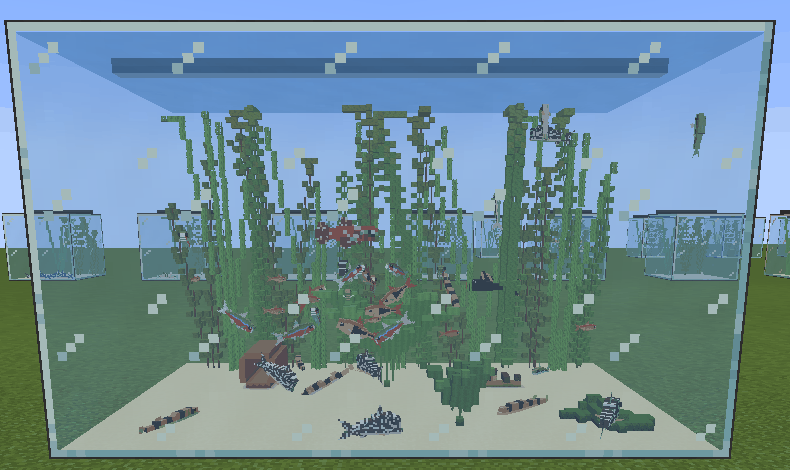

---
navigation:
  title: Reef technique
  icon: bettacraft:protein_skimmer
  parent: saltwater.md
  position: 2
item_ids:
  - bettacraft:protein_skimmer
  - bettacraft:flow_pump
  - bettacraft:reef_rock
  - bettacraft:live_rock
---

# Reef technique

## Protein skimmer

Hang it on a side of the tank like the [external filter](../equipment.md). In salt water it foams the waste out: an extra
filter for 48 water blocks (config `saltwater.skimmerBlocks`). In fresh water nothing foams and it does nothing. With
`power.filterRequiresEnergy` it needs the power of a filter.

## Flow pump

Corals need moving water. Place flow pumps in the tank interior under water like the internal filter (a 2x2x2 box at
scale 16, the outlet facing away from you). One pump moves 24 water blocks enough for the corals that want strong flow
(`saltwater.pumpFlowBlocks`); the outlets of external filters count a third of a pump, internal filters a sixth. The menu
shows the **flow** in %: mushrooms and zoanthids are happy from 15 %, most corals from 35 %, Acropora wants 70 %; far
above 160 to 300 % the tissue tears.

## Light

Corals live on the light of their algae: under a [tank light](../equipment.md) they grow, in the dark not at all. The
colour matters (the M18 coloured lights): **actinic** blue light (blue, light blue, cyan or purple) mixed with white is
best (100 %), only blue 85 %, only white 70 %, other colours 40 %, sunlight 60 %. Under actinic light the corals glow
in their brightest colours.

## Reef rock and live rock

* **Reef rock** (4 from calcite and sand): porous rock for the rock work in the interior. Corals and the anemone are glued
  onto it (also onto live rock and coral blocks).
* **Live rock** (8 reef rock around a coral, or from the wandering trader): reef rock full of coralline algae and bacteria.
  In salt water it cleans the water without power: one tank block of live rock (16x16x16 interior blocks) keeps 24 water
  blocks clean (`saltwater.liveRockBlocks`).
