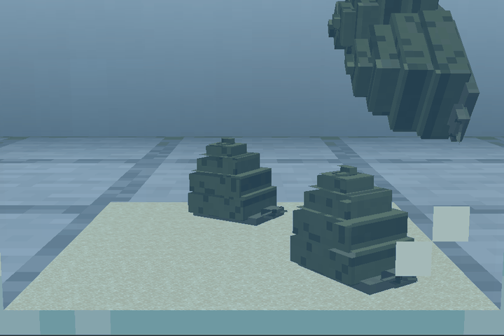

---
navigation:
  title: Mexican Turbo Snail
  icon: bettacraft:fish_bag
  parent: saltwater/reef_invertebrates.md
  position: 30
---

# Mexican Turbo Snail

The Mexican turbo snail (*Turbo fluctuosa*) from the Gulf of California: a large snail with a ridged shell, the best algae grazer of a reef tank.

## Profile

| | |
|---|---|
| Group | Snails |
| Size in the game | about 3.5 cm (0.3 blocks) |
| Temperature | 22–28 °C |
| Water | sea water, sensitive |
| Breeding | does not breed in a tank |
| Algae | grazes 2.5 glass faces a day |
| Climbs the glass | yes |
| Stocking | 50 count as one fish |

## Care

* Keeps the glass and the rock clean (2.5 glass faces a day).
* Sea water only; it does not breed in a tank.

## Obtaining

* **[Aquarium net](../equipment/tank_net.md)** in warm oceans (coral reefs): 9.6–12 % per swing, 1–2 at a time.
* **[Aquarium net](../equipment/tank_net.md)** in lukewarm oceans: 11–13 % per swing, 1–2 at a time.
