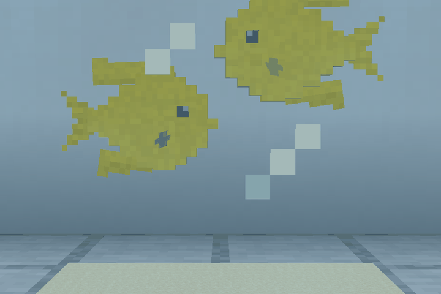

---
navigation:
  title: Yellow Tang
  icon: bettacraft:yellow_tang_bucket
  parent: saltwater/reef_animals.md
  position: 20
item_ids:
  - bettacraft:yellow_tang_bucket
  - bettacraft:yellow_tang_spawn_egg
---

# Yellow Tang

The yellow tang (*Zebrasoma flavescens*) from the reefs of Hawaii: a bright yellow, disc-shaped surgeonfish that grazes algae off the rock all day.

## Profile

| | |
|---|---|
| Group | Tangs |
| Scientific name | *Zebrasoma flavescens* |
| Size in the game | about 9 cm (0.75 blocks) |
| Temperature | 24–28 °C |
| Water | sea water, sensitive |
| Water chemistry | pH 7.8–8.6 |
| Shoal | alone or as a pair |
| Swims | in the middle |
| Stocking | counts as 2.5 fish |
| Breeding | Does not breed in a tank |
| Special | eats algae |

## Care

* A big fish (counts as 2.5): it needs room and clean water.
* It **grazes algae** like a pleco and harasses seahorses.
* It does not breed in a tank.

## Obtaining

* **[Aquarium net](../equipment/tank_net.md)** in warm oceans (coral reefs): 1–1.2 % per swing (about 1 in 81–96 swings).
* **Wild** in warm oceans (coral reefs), in groups of 1–1 (spawn weight 3) (config `features.wildFish`).
* **Wandering trader** (rare offers): 2 for 9 emeralds; one of 3 in this offer.

The biomes of biome mods count too ([biome tags](../settings.md)).
