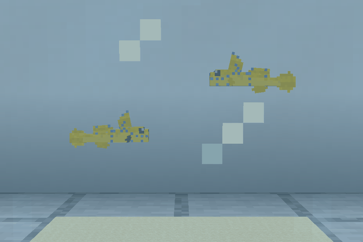

---
navigation:
  title: Yellow Watchman Goby
  icon: bettacraft:yellow_watchman_goby_bucket
  parent: saltwater/reef_animals.md
  position: 30
item_ids:
  - bettacraft:yellow_watchman_goby_bucket
  - bettacraft:yellow_watchman_goby_spawn_egg
---

# Yellow Watchman Goby

The yellow watchman goby (*Cryptocentrus cinctus*) from the lagoons of the western Pacific: a yellow goby with blue dots that sits on the sand in front of its burrow and keeps watch.

## Profile

| | |
|---|---|
| Group | Gobies |
| Scientific name | *Cryptocentrus cinctus* |
| Size in the game | about 5 cm (0.42 blocks) |
| Temperature | 22–28 °C |
| Water | sea water, normal |
| Water chemistry | pH 7.8–8.6 |
| Shoal | alone or as a pair |
| Swims | on the bottom |
| Stocking | counts as 0.6 fish |
| Breeding | Does not breed in a tank |

## Care

* Lives **on the bottom**; sand as substrate suits it.
* Peaceful: a good companion for seahorses.
* It does not breed in a tank.

## Obtaining

* **[Aquarium net](../equipment/tank_net.md)** in warm oceans (coral reefs): 1.7–2 % per swing (about 1 in 50–60 swings).
* **[Aquarium net](../equipment/tank_net.md)** in lukewarm oceans: 2.3–2.7 % per swing (about 1 in 37–44 swings).
* **Wild** in warm oceans (coral reefs), alone (spawn weight 4) (config `features.saltwater.reefFish`).
* **Wild** in lukewarm oceans, alone (spawn weight 3) (config `features.saltwater.reefFish`).
* **Wandering trader** (usual offers): 2 for 3 emeralds; one of 4 in this offer.

The biomes of biome mods count too ([biome tags](../settings.md)).
