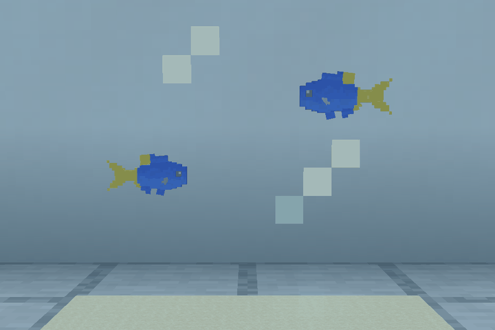

---
navigation:
  title: Yellowtail Damsel
  icon: bettacraft:yellowtail_damsel_bucket
  parent: saltwater/reef_animals.md
  position: 50
item_ids:
  - bettacraft:yellowtail_damsel_bucket
  - bettacraft:yellowtail_damsel_spawn_egg
---

# Yellowtail Damsel

The yellowtail damselfish (*Chrysiptera parasema*) from the western Pacific: a bright blue little fish with a yellow tail, hardy and a good first reef fish.

## Profile

| | |
|---|---|
| Group | Damselfish |
| Scientific name | *Chrysiptera parasema* |
| Size in the game | about 4 cm (0.33 blocks) |
| Temperature | 23–28 °C |
| Water | sea water, also strong brackish water, hardy |
| Water chemistry | pH 7.8–8.6 |
| Shoal | alone or as a pair |
| Swims | in the lower water |
| Stocking | counts as 0.45 fish |
| Breeding | Does not breed in a tank |

## Care

* **Hardy**: it also takes strong brackish water from 20 ‰.
* It chases seahorses.
* It does not breed in a tank.

## Obtaining

* **[Aquarium net](../equipment/tank_net.md)** in warm oceans (coral reefs): 2.1–2.5 % per swing (about 1 in 40–48 swings).
* **[Aquarium net](../equipment/tank_net.md)** in lukewarm oceans: 4.5–5.4 % per swing (about 1 in 19–22 swings).
* **Wild** in warm oceans (coral reefs), in groups of 1–1 (spawn weight 5) (config `features.wildFish`).
* **Wild** in lukewarm oceans, in groups of 1–1 (spawn weight 6) (config `features.wildFish`).
* **Wandering trader** (usual offers): 2 for 3 emeralds; one of 4 in this offer.
