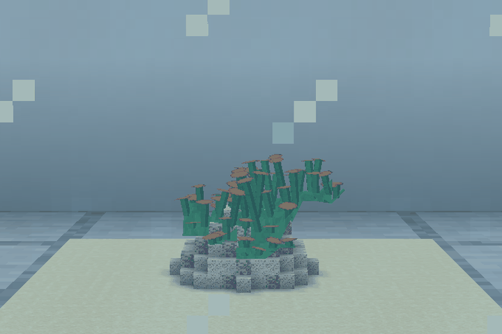

---
navigation:
  title: Zoanthids
  icon: bettacraft:zoanthus
  parent: saltwater/corals.md
  position: 10
item_ids:
  - bettacraft:zoanthus
---

# Zoanthids

Zoanthids (*Zoanthus* sp.), button polyps from tropical reefs worldwide: colonies of small polyps on short columns over a thin mat, in green, orange and gold.

## Profile

| | |
|---|---|
| Growth form | polyp mat (soft coral) |
| Grows on | reef rock, live rock |
| Light | medium |
| Flow | gentle |
| Calcium | not needed (soft coral) |
| Water | sea water |
| Full size | after about 5 days |
| Spreads | over the rock |
| Cuttings per trim | 2 |

## Care

* Easy soft coral: medium light, gentle flow, no calcium.
* Spreads over the rock by itself; the polyps **close for a moment** when a fish swims by.

## Obtaining

* **[Aquarium net](../equipment/tank_net.md)** in warm oceans (coral reefs): 0.75–0.9 % per swing.
* **Wandering trader** (usual offers): 2 for 4 emeralds; one of 4 in this offer.
* **Frags**: shears on a grown coral give 2 cuttings per trim; it also spreads by itself (over the rock).
