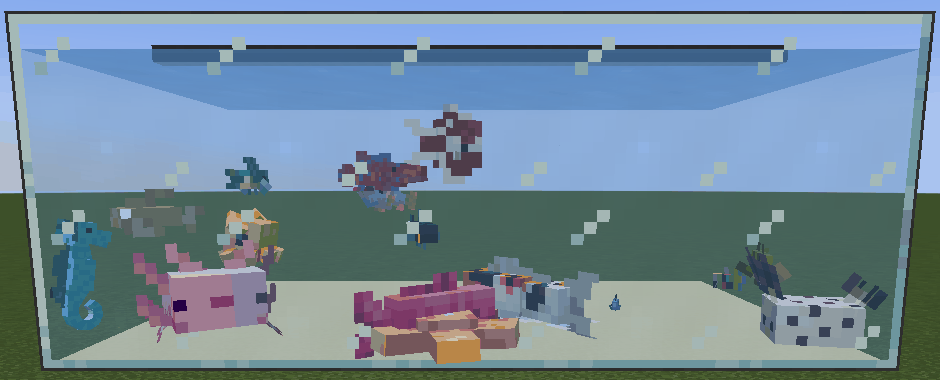
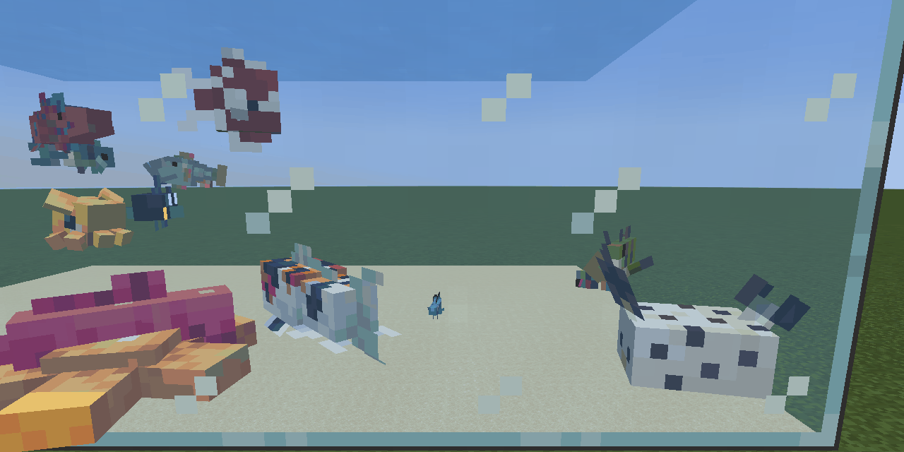

---
navigation:
  title: Animals of other mods
  icon: minecraft:axolotl_bucket
  parent: settings.md
  position: 10
---

# Animals of other mods

Every small water animal of vanilla Minecraft and of other mods can live in a Bettacraft aquarium: fish, axolotls,
tadpoles, squids, sea slugs, seahorses, starfish and more. Bettacraft does not need to know the mod; it looks at the
animal itself. Put it in with its own bucket or with a fish bag (see [Inhabitants](../aquarium/inhabitants.md)).

## What is refused

The aquarium refuses an animal with a message that says why:

* **too big:** its hitbox is wider or taller than 0.8 blocks (`inhabitants.maxHitbox`). The size of the animal itself
  counts, so variants of other mods differ: a Fintastic dwarf gourami fits, a giant gourami does not. Dolphins, turtles,
  sharks, whales, rays and the like are too big.
* **a boss** (`#c:bosses`), e.g. the Leviathan of L_Ender's Cataclysm.
* **hostile:** mobs of the spawn category monster, e.g. guardians or the Cataclysm lionfish (`inhabitants.refuseHostile`).
* **no water animal:** land animals in buckets of other mods (Naturalist's butterflies, snails, crabs ...).
* **does not belong in an aquarium:** animals in `#bettacraft:tank_blacklist`. These are giant fish with small
  hitboxes (Aquaculture's tuna, arapaima, halibut, carp ...; Fintastic's arapaima and coelacanth), the manta ray of Living
  Things, the tuna of Sushi Go Crafting, frogs, the otter of Critters and Companions and the pets of L_Ender's Cataclysm
  (they follow and teleport to their owner).

Server owners can change this: `inhabitants.allow` always lets an animal in (`modid:name` or `modid:*`),
`inhabitants.deny` never; the entity tags `#bettacraft:tank_inhabitants` and `#bettacraft:tank_blacklist` do the same in
a data pack. `/bettacraft wateranimals` (operators) lists every water animal of the loaded mods and whether aquariums
take it, in `bettacraft-water-animals.tsv` in the server folder.

## In the aquarium

Animals of other mods keep their own behaviour. Bettacraft holds them in the water of the real tank shape and counts
them for the stocking. Animals **with a profile** (the fish of Fintastic, Aquaculture, Naturalist and the koi of Critters
and Companions by default) also get our care in the aquarium: hunger, their temperature and water, sickness and death,
and they breed by our rules, see [Profiles for animals of other mods](foreign_profiles.md). Animals without a profile
are never hurt by our care. The vanilla **axolotl** has its own care and breeding (cool water, eggs on the plants, colour
genetics), see [Axolotl](../invertebrates/axolotl.md).

* **Predators** (`#bettacraft:predators`) hunt small fish and fry: pufferfish, **axolotls**, piranhas, the Otherside
  angler fish and the predators of the aquarium mods. See [Fights, flaring and predators](../bettas/fighting.md).
* **Tadpoles** grow up in the aquarium. The young frog hops out and lands in front of the tank (log entry). With
  `inhabitants.tadpoles = STAY_TADPOLE` they stay tadpoles as long as they live in an aquarium.
* **Squids and glow squids** have no bucket: catch them with a fish bag, which keeps the whole animal. They also come
  out with a fish bag only.
* **Fintastic** swaps vanilla cod and salmon for its own when they spawn. A cod or salmon from a bucket stays what it is
  in a Bettacraft aquarium.
* **Their own breeding** (love from food, the breeding of their mod) is suppressed in a Bettacraft aquarium
  (`features.suppressForeignBreeding`); outside it nothing changes. Animals with a profile breed by our rules instead.
