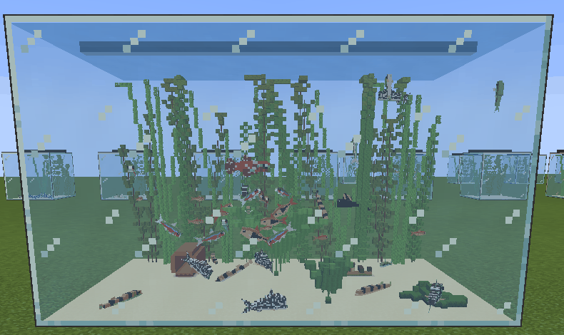
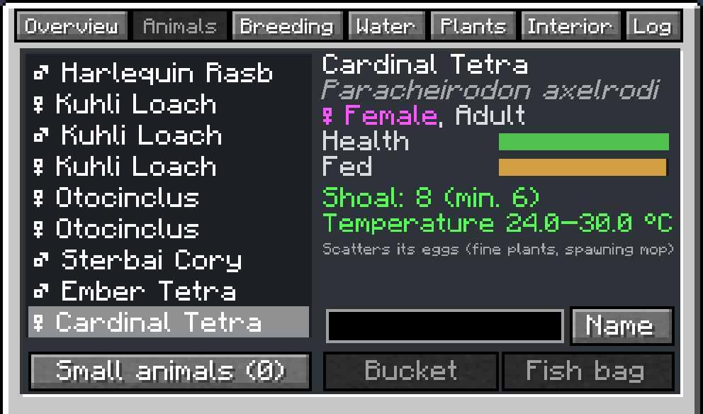

---
navigation:
  title: Tankmates
  icon: bettacraft:neon_tetra_bucket
  parent: index.md
  position: 66
---

# Tankmates

Twenty popular aquarium fish can share a tank with the bettas (or live without them): **tetras**, **rasboras**,
**corydoras**, **plecos**, **otocinclus**, **loaches**, the **livebearers** guppy, endler and platy, and the **dwarf
gourami**. They are real animals like the bettas, swim in the zone of the water their species likes, shoal with their
kind, rest on the bottom or stick to the glass, and every species breeds the way it does in nature.

* [Care](tankmates/care.md): shoals, temperature, water, food, stocking, bettas and other tankmates.
* [Breeding](tankmates/breeding.md): eggs on the glass, caves, egg scatterers, livebearers, foam nests; the breeding
  box, the spawning cave and mop, fry powder.

## In short

* They come in a **bucket** of their species or in a **fish bag** (a whole shoal fits into one bag). Right-click the
  tank to put them in; the menu takes them out one by one.
* A shoaling fish alone or in a small group is **stressed** and gets sick after a while: keep at least the minimum.
* Every species has its **temperature range**; the classic betta tank (26-28 °C) suits the cardinal, ember, harlequin,
  mosquito rasbora, sterbai cory, kuhli loach and the L-numbers, not the neon, the panda cory or the platy.
* **Male bettas chase male guppies and dwarf gouramis**. Every adult eats the fry and the eggs it can reach.
* The [tank menu](aquarium/menu.md) shows each fish with its shoal, temperature and breeding state, the breeding tab
  the clutches of every species; Jade, The One Probe and WTHIT list the tankmates.

## All species

| Species | °C | Shoal | Betta tank | Breeding |
|---|---|---|---|---|
| [Neon Tetra](tankmates/neon_tetra.md) | 20–27 | 6 | too cool | Scatters its eggs (fine plants, spawning mop) |
| [Cardinal Tetra](tankmates/cardinal_tetra.md) | 24–30 | 6 | yes | Scatters its eggs (fine plants, spawning mop) |
| [Ember Tetra](tankmates/ember_tetra.md) | 22–29 | 6 | yes | Scatters its eggs (fine plants, spawning mop) |
| [Glowlight Tetra](tankmates/glowlight_tetra.md) | 23–28 | 6 | yes | Scatters its eggs (fine plants, spawning mop) |
| [Harlequin Rasbora](tankmates/harlequin_rasbora.md) | 22–28 | 6 | yes | Scatters its eggs (fine plants, spawning mop) |
| [Mosquito Rasbora](tankmates/mosquito_rasbora.md) | 22–28 | 8 | yes | Scatters its eggs (fine plants, spawning mop) |
| [Pygmy Cory](tankmates/pygmy_cory.md) | 22–27 | 8 | too cool | Glues its eggs to the glass (after a cool water change) |
| [Panda Cory](tankmates/panda_cory.md) | 20–26 | 6 | too cool | Glues its eggs to the glass (after a cool water change) |
| [Sterbai Cory](tankmates/sterbai_cory.md) | 24–30 | 6 | yes | Glues its eggs to the glass (after a cool water change) |
| [Green Gold Cory](tankmates/green_gold_cory.md) | 22–27 | 6 | too cool | Glues its eggs to the glass (after a cool water change) |
| [L134 Leopard Frog Pleco](tankmates/leopard_frog_pleco.md) | 25–30 | – | yes | Spawns in a cave, the male guards |
| [L046 Zebra Pleco](tankmates/zebra_pleco.md) | 26–31 | – | yes | Spawns in a cave, the male guards |
| [Bristlenose Pleco](tankmates/bristlenose_pleco.md) | 21–28 | – | yes | Spawns in a cave, the male guards |
| [Otocinclus](tankmates/otocinclus.md) | 21–27 | 5 | too cool | Glues its eggs to the glass (after a cool water change) |
| [Kuhli Loach](tankmates/kuhli_loach.md) | 24–30 | 5 | yes | Scatters its eggs (fine plants, spawning mop) |
| [Clown Loach](tankmates/clown_loach.md) | 25–30 | 5 | too big | Does not breed in a tank |
| [Guppy](tankmates/guppy.md) | 22–28 | 3 | females only | Bears live young |
| [Endler Guppy](tankmates/endler_guppy.md) | 23–30 | 3 | yes | Bears live young |
| [Platy](tankmates/platy.md) | 20–27 | 3 | too cool | Bears live young |
| [Dwarf Gourami](tankmates/dwarf_gourami.md) | 24–29 | – | no | Builds a foam nest |
