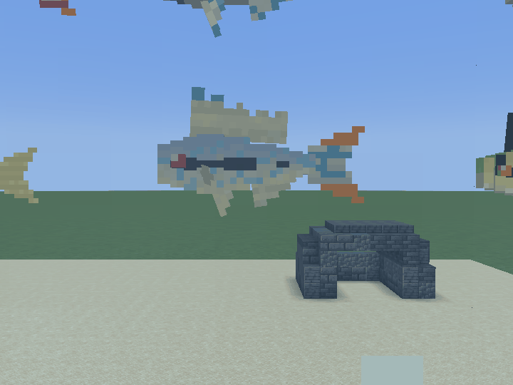

---
navigation:
  title: Agassiz's Dwarf Cichlid
  icon: bettacraft:agassiz_dwarf_cichlid_bucket
  parent: tankmates/cichlids.md
  position: 40
item_ids:
  - bettacraft:agassiz_dwarf_cichlid_bucket
  - bettacraft:agassiz_dwarf_cichlid_spawn_egg
---

# Agassiz's Dwarf Cichlid

The male is bluish with a long dorsal fin and an orange and blue framed spade tail; the female is yellow with a dark stripe.

**Origin:** the soft blackwater of the Amazon basin.

## Profile

| | |
|---|---|
| Group | Cichlids |
| Scientific name | *Apistogramma agassizii* |
| Size in the game | about 6.5 cm (0.55 blocks) |
| Temperature | 24–29 °C |
| Breeding temperature | 26–29 °C |
| Water | fresh water, sensitive |
| Water chemistry | pH 5.0–7.2, TDS 0–250 ppm |
| Shoal | alone or as a pair |
| Swims | in the lower water |
| Stocking | counts as 0.7 fish |
| Breeding | Cave brooder: the female spawns in a small cave and guards the brood, 15–45 young |
| Betta tank | with care (big tank) |
| Special | guards its brood, territorial, 2 colour varieties |

## Varieties

Varieties: Wild type, Fire Red. The wild type is dominant, the bred varieties are recessive: only two equal alleles show the colour (carriers look wild). Of two different bred varieties the one listed first shows. Wild fish now and then carry a bred variety hidden; the menu shows the genes in a tooltip.

## Breeding

Every adult female claims a **small cave** of her own: the [coconut shell](../interior/decor/tubes.md) and the slate cave first, then the spawning caves the plecos leave free. At 26–29 °C she spawns 15–45 eggs in it with the male, guards eggs and young alone and **drives every other fish away** (config `tankmates.behaviour.broodDefence`). A female without a cave is chased by the owners; keep one male with one or more females and a cave for each. Without its mother the brood dies.

## Keeping

* Needs soft, acidic water (peat, almond leaves, osmosis water).
* Males are territorial: each needs about 4 water blocks; in a smaller tank the extra males are chased and bitten.

## Obtaining

* **[Aquarium net](../equipment/tank_net.md)** in jungle water: 0.22–0.26 % per swing (about 1 in 380–450 swings).
* **Wild** in jungle water, in groups of 1–1 (spawn weight 2) (config `features.cichlids`).
* **Wandering trader** (usual offers): 2 for 3 emeralds; one of 20 in this offer.
* **[Breeding](breeding.md)**: Cave brooder: the female spawns in a small cave and guards the brood.

The biomes of biome mods count too ([biome tags](../settings.md)).
