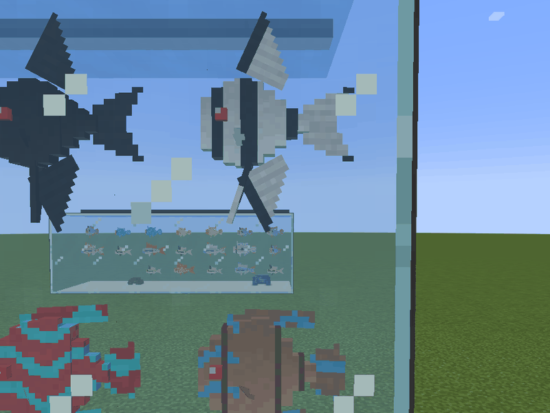

---
navigation:
  title: Angelfish
  icon: bettacraft:angelfish_bucket
  parent: tankmates/cichlids.md
  position: 50
item_ids:
  - bettacraft:angelfish_bucket
  - bettacraft:angelfish_spawn_egg
---

# Angelfish

The tall, flat cichlid with huge swept-back fins and long pelvic threads; silver with black bars in the wild.

**Origin:** calm, plant-rich waters of the Amazon.

## Profile

| | |
|---|---|
| Group | Cichlids |
| Scientific name | *Pterophyllum scalare* |
| Size in the game | about 11 cm (0.9 blocks) |
| Temperature | 24–30 °C |
| Breeding temperature | 26–29 °C |
| Water | fresh water, normal |
| Water chemistry | pH 6.0–8.0, TDS 0–500 ppm |
| Shoal | alone or as a pair |
| Swims | in the middle |
| Stocking | counts as 2 fish |
| Breeding | Open brooder: the pair spawns on a stone, leaf or the glass and guards the brood, 30–80 young |
| Betta tank | no (big, nips fins) |
| Special | eats small fish and shrimp, guards its brood, 5 colour varieties |

## Varieties

Varieties: Wild type (silver), Black, Marble, Koi, Platinum. The wild type is dominant, the bred varieties are recessive: only two equal alleles show the colour (carriers look wild). Of two different bred varieties the one listed first shows. Wild fish now and then carry a bred variety hidden; the menu shows the genes in a tooltip.

## Breeding

At 26–29 °C a pair forms: the male and the nearest free female clean a **broad leaf** (sword plants, anubias) or else **the glass** and spawn 30–80 eggs there. Both parents stay at the brood, fan the eggs and **drive every other fish away** (bettas too: the intruder flees and takes a bite, config `tankmates.behaviour.broodDefence`). Guarded eggs are safe from the other fish; when both parents are gone, the brood dies.

## Keeping

* **Eats small fish and shrimp**: neons, embers, mosquito rasboras and other tankmates up to 3 cm, and every shrimp (config `tankmates.behaviour.angelfishPreyPerDay`). Plants hide some of them.
* Not with bettas: it nips their fins and the betta nips back. Big (counts 2 fish) and tall: give it a high tank. One fits in a bucket or fish bag.

## Obtaining

* **[Aquarium net](../equipment/tank_net.md)** in jungle water: 0.18–0.21 % per swing (about 1 in 473–561 swings).
* **Wild** in jungle water, alone (spawn weight 2) (config `features.tankmates.cichlids`).
* **Wandering trader** (usual offers): 2 for 5 emeralds; one of 36 in this offer.
* **[Aquarist villager](../getting_started/aquarist.md)** (Master): 2 for 14 emeralds; one of about 14 in this offer (config `features.tankmates.cichlids`).
* **[Breeding](breeding.md)**: Open brooder: the pair spawns on a stone, leaf or the glass and guards the brood.

The biomes of biome mods count too ([biome tags](../settings.md)).
