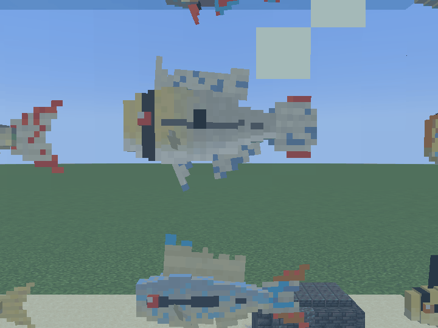

---
navigation:
  title: Bolivian Ram
  icon: bettacraft:bolivian_ram_bucket
  parent: tankmates/cichlids.md
  position: 20
item_ids:
  - bettacraft:bolivian_ram_bucket
  - bettacraft:bolivian_ram_spawn_egg
---

# Bolivian Ram

Bigger, calmer and hardier than the ram: beige with a yellow front, a black spot in the middle and red fin edges.

**Origin:** the Río Mamoré and Río Guaporé in Bolivia and Brazil.

## Profile

| | |
|---|---|
| Group | Cichlids |
| Scientific name | *Mikrogeophagus altispinosus* |
| Size in the game | about 7.5 cm (0.62 blocks) |
| Temperature | 22–29 °C |
| Breeding temperature | 25–28 °C |
| Water | fresh water, normal |
| Water chemistry | pH 6.0–8.0, TDS 0–450 ppm |
| Shoal | alone or as a pair |
| Swims | in the lower water |
| Stocking | counts as 1 fish |
| Breeding | Open brooder: the pair spawns on a stone, leaf or the glass and guards the brood, 20–60 young |
| Betta tank | with care (big tank) |
| Special | guards its brood, territorial |

## Breeding

At 25–28 °C a pair forms: the male and the nearest free female clean a **flat stone** (else a pit in the substrate) and spawn 20–60 eggs there. Both parents stay at the brood, fan the eggs and **drive every other fish away** (bettas too: the intruder flees and takes a bite, config `tankmates.behaviour.broodDefence`). Guarded eggs are safe from the other fish; when both parents are gone, the brood dies.

## Keeping

* Takes cooler and harder water than the ram (22–29 °C).
* Males are territorial: each needs about 3 water blocks; in a smaller tank the extra males are chased and bitten.

## Obtaining

* **[Aquarium net](../equipment/tank_net.md)** in rivers: 0.36–0.42 % per swing (about 1 in 238–281 swings).
* **[Aquarium net](../equipment/tank_net.md)** in jungle water: 0.09–0.11 % per swing (about 1 in 947–1121 swings).
* **Wild** in rivers, alone (spawn weight 2) (config `features.cichlids`).
* **Wild** in jungle water, alone (spawn weight 1) (config `features.cichlids`).
* **Wandering trader** (rare offers): 2 for 7 emeralds; one of 12 in this offer.
* **[Breeding](breeding.md)**: Open brooder: the pair spawns on a stone, leaf or the glass and guards the brood.

The biomes of biome mods count too ([biome tags](../settings.md)).
