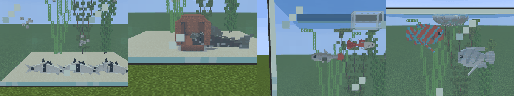
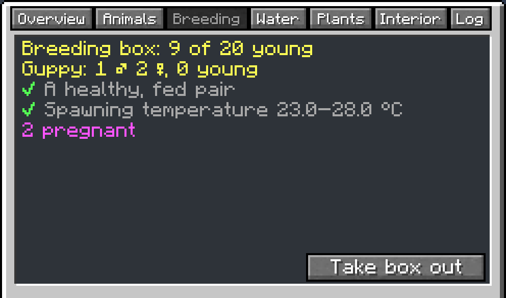

---
navigation:
  title: Breeding the tankmates
  icon: bettacraft:breeding_box
  parent: tankmates.md
  position: 20
item_ids:
  - bettacraft:fry_powder
  - bettacraft:algae_wafer
  - bettacraft:spawning_cave
  - bettacraft:spawning_mop
  - bettacraft:decor_spawning_cave
  - bettacraft:decor_spawning_mop
---

# Breeding the tankmates

Every species breeds in its own way. What they all need: a **healthy, fed pair** of adults, the **spawning temperature**
of their species (the breeding tab lists it) and room in the tank (a full tank gets no young). Live food (mosquito
larvae) gets them ready faster. The breeding tab of the [tank menu](../aquarium/menu.md) shows the conditions and the
clutches of every species in the tank.

## Eggs on the glass: corydoras, otocinclus

* **Corydoras spawn after a cool water change**: replace at least a quarter of the water within a quarter of a day with
  fresh water that cools the tank by 1.5 °C (fresh water has the ambient temperature; `coolChangeShare`,
  `coolChangeDrop`). The log notes the cool water change; for a day the corys are in the mood.
* The female glues her eggs in small groups to the **glass**, the decoration and broad leaves. After one day they hatch,
  half a day later the fry swim free.
* The other fish eat the eggs: take a clutch out with the **aquarium net** (aim at it; it goes into an empty fish bag)
  and right-click it into a tank without adults to raise the young.
* Otocinclus lay a few eggs now and then without a water change.

## Caves: plecos

* L134, L046 and the bristlenose need a <ItemLink id="bettacraft:decor_spawning_cave" /> in the
  [interior](../interior.md) (or your own cave of <ItemLink id="bettacraft:spawning_cave" />, 20 connected blocks or
  more). Every adult male takes a cave; males without one are chased off.
* A pair spawns in the cave, the **male guards** the eggs and the larvae; they are safe from the other fish. Without the
  male the clutch dies.

## Egg scatterers: tetras, rasboras, kuhli loaches

* At the spawning temperature a pair scatters its eggs into **fine-leaved plants** (rotala, ludwigia, alternanthera,
  java moss, mini needle) or a <ItemLink id="bettacraft:decor_spawning_mop" /> (three
  <ItemLink id="bettacraft:spawning_mop" /> and a stone). Harlequin rasboras spawn under **broad leaves** instead.
* **The parents eat the eggs**, so do all other fish: in the spawning mop 80 % are out of reach, in dense plants many.
  Without plants or mop the eggs fall onto the bare ground and are eaten.
* The eggs hatch after a third of a day, the young swim free half a day later.

## Livebearers: guppies, endlers, platys

* A female with a male gets **pregnant** (the menu shows how far) and gives birth to live young after 3 days
  (`gestationDays`).
* The adults eat the fry. A <ItemLink id="bettacraft:breeding_box" /> catches them: right-click the tank with it, it
  hangs inside the front glass; the young born while it is there are safe until they are juveniles, then they swim out
  (at most 20). Take it out in the breeding tab.

## Foam nest: dwarf gourami

* Like a [betta](../bettas/breeding.md): the male builds a foam nest at the surface (floating plants help), the female spawns
  into it, then the male guards the nest and chases her away - take her out.

## Clown loaches

* They do not breed in a tank (in nature they migrate to spawn). Every clown loach comes from the net or the trader.

## Fry food

* <ItemLink id="bettacraft:fry_powder" /> feeds the fry of every species (also betta fry) through the whole fry stage;
  craft it from two betta pellets and bone meal. Infusoria and artemia work like for the bettas.
* <ItemLink id="bettacraft:algae_wafer" /> for the bottom fish: dried kelp and pellets.

## Obtaining

Crafting:

<RecipesFor id="bettacraft:fry_powder" />
<RecipesFor id="bettacraft:algae_wafer" />
<RecipesFor id="bettacraft:spawning_cave" />
<RecipesFor id="bettacraft:spawning_mop" />
<RecipesFor id="bettacraft:decor_spawning_cave" />
<RecipesFor id="bettacraft:decor_spawning_mop" />
