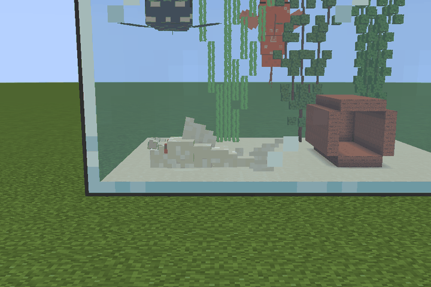

---
navigation:
  title: Bristlenose Pleco
  icon: bettacraft:bristlenose_pleco_bucket
  parent: tankmates.md
  position: 22
item_ids:
  - bettacraft:bristlenose_pleco_bucket
  - bettacraft:bristlenose_pleco_spawn_egg
---

# Bristlenose Pleco

The best algae eater of the tankmates; males grow bristles on the snout. Also albino and super red.

| | |
|---|---|
| Family | Plecos |
| Scientific | *Ancistrus sp.* |
| Size in the game | about 8 cm (0.7 blocks) |
| Origin | South American rivers; the aquarium form is bred everywhere |
| Temperature | 21–28 °C |
| Shoal | alone or in pairs |
| Water | hardy |
| Stocking | 1.2 fish |
| Breeding | Spawns in a cave, the male guards, 23–27 °C |

## Varieties

Varieties: Wild type, Albino, Super Red. The wild type is dominant, the bred varieties are recessive: only two equal alleles show the colour (carriers look wild). Of two different bred varieties the one listed first shows. Wild fish now and then carry a bred variety hidden; the menu shows the genes in a tooltip.

## Breeding

Needs a **spawning cave** (decoration) and 23–27 °C. Every male claims a cave; a pair spawns 15–40 eggs in it and the male guards eggs and larvae until the young swim out. Without the male the clutch dies.

## Keeping

* Grazes the algae off the glass and partly lives on them; without algae it needs algae wafers.
* Bottom fish: gets only part of the sinking food while faster fish are around - algae wafers go straight to it.
* Males defend their cave: give several males several caves.

## Getting it

With the [aquarium net](../invertebrates/catching.md) in jungle water, rivers and from the wandering trader; then by breeding.
