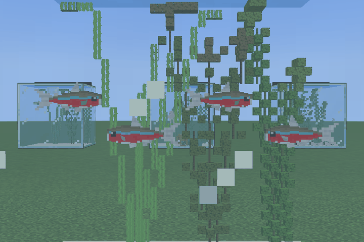

---
navigation:
  title: Cardinal Tetra
  icon: bettacraft:cardinal_tetra_bucket
  parent: tankmates.md
  position: 11
item_ids:
  - bettacraft:cardinal_tetra_bucket
  - bettacraft:cardinal_tetra_spawn_egg
---

# Cardinal Tetra

Like the neon, but the red runs the whole length of the belly; likes it warmer, good with bettas.

| | |
|---|---|
| Family | Tetras |
| Scientific | *Paracheirodon axelrodi* |
| Size in the game | about 4 cm (0.32 blocks) |
| Origin | the Rio Negro and Orinoco (Brazil, Venezuela), warm blackwater |
| Temperature | 24–30 °C |
| Shoal | 6 or more |
| Water | very sensitive |
| Stocking | 0.4 fish |
| Breeding | Scatters its eggs (fine plants, spawning mop), 26–28 °C |

## Breeding

At 26–28 °C a pair scatters 20–50 eggs into fine-leaved plants, java moss or a **spawning mop**. The parents and every other fish eat the eggs they reach; in a spawning mop most are safe. Live food (mosquito larvae) gets them ready faster.

## Getting it

With the [aquarium net](../invertebrates/catching.md) in jungle water and from the wandering trader; then by breeding.
