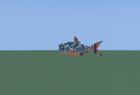

---
navigation:
  title: Celestial Pearl Danio
  icon: bettacraft:celestial_pearl_danio_bucket
  parent: tankmates/rasboras.md
  position: 40
item_ids:
  - bettacraft:celestial_pearl_danio_bucket
  - bettacraft:celestial_pearl_danio_spawn_egg
---

# Celestial Pearl Danio

A tiny jewel: blue-grey with golden pearl spots; the male has an orange belly and red-orange fins with black bars.

**Origin:** small, plant-filled ponds in the hills of Myanmar.

## Profile

| | |
|---|---|
| Group | Rasboras |
| Scientific name | *Celestichthys margaritatus* |
| Size in the game | about 2 cm (0.17 blocks) |
| Temperature | 20–26 °C |
| Breeding temperature | 22–25 °C |
| Water | fresh water, sensitive |
| Water chemistry | pH 5.0–7.8, TDS 0–450 ppm |
| Shoal | from 6 fish |
| Swims | in the lower water |
| Stocking | counts as 0.15 fish |
| Breeding | Scatters its eggs (fine plants, spawning mop), 10–30 young |
| Betta tank | too cool |

## Breeding

At 22–25 °C a pair scatters 10–30 eggs into fine-leaved plants, java moss or a **spawning mop**. The parents and every other fish eat the eggs they reach; in a spawning mop most are safe. Live food gets them ready faster.

## Keeping

* Shy: stays low between dense plants; soft water, 20–26 °C.
* Small enough for a nano tank and calm enough for a betta tank (at its upper temperature end).

## Obtaining

* **[Aquarium net](../equipment/tank_net.md)** in swamps: 0.8–0.95 % per swing (about 1 in 106–125 swings), 1–4 at a time.
* **Wild** in swamps, in groups of 3–6 (spawn weight 4) (config `features.communityFish`).
* **Wandering trader** (usual offers): 6 for 3 emeralds; one of 36 in this offer.
* **[Breeding](breeding.md)**: Scatters its eggs (fine plants, spawning mop).

The biomes of biome mods count too ([biome tags](../settings.md)).
