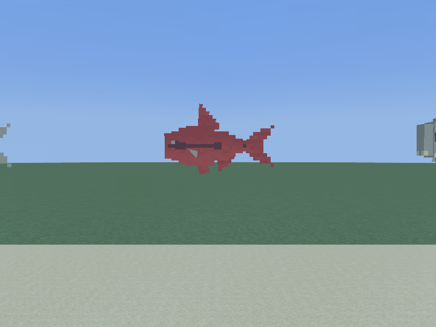

---
navigation:
  title: Cherry Barb
  icon: bettacraft:cherry_barb_bucket
  parent: tankmates/barbs.md
  position: 30
item_ids:
  - bettacraft:cherry_barb_bucket
  - bettacraft:cherry_barb_spawn_egg
---

# Cherry Barb

A small, calm barb with a dark stripe along the side: the male turns cherry red, the female stays beige.

**Origin:** the shady forest streams of Sri Lanka.

## Profile

| | |
|---|---|
| Group | Barbs |
| Scientific name | *Rohanella titteya* |
| Size in the game | about 5 cm (0.4 blocks) |
| Temperature | 22–28 °C |
| Breeding temperature | 24–27 °C |
| Water | fresh water, normal |
| Water chemistry | pH 6.0–8.0, TDS 0–500 ppm |
| Shoal | from 6 fish |
| Swims | in the middle |
| Stocking | counts as 0.4 fish |
| Breeding | Scatters its eggs (fine plants, spawning mop), 20–50 young |
| Betta tank | yes |

## Breeding

At 24–27 °C a pair scatters 20–50 eggs into fine-leaved plants, java moss or a **spawning mop**. The parents and every other fish eat the eggs they reach; in a spawning mop most are safe. Live food gets them ready faster.

## Keeping

* Peaceful: one of the few barbs that fits a betta tank (22–28 °C).

## Obtaining

* **[Aquarium net](../equipment/tank_net.md)** in rivers: 0.27–0.32 % per swing (about 1 in 317–375 swings), 1–4 at a time.
* **[Aquarium net](../equipment/tank_net.md)** in jungle water: 0.27–0.32 % per swing (about 1 in 316–374 swings), 1–4 at a time.
* **Wild** in rivers, in groups of 3–6 (spawn weight 2) (config `features.barbsAndLoaches`).
* **Wild** in jungle water, in groups of 3–6 (spawn weight 3) (config `features.barbsAndLoaches`).
* **Wandering trader** (usual offers): 6 for 4 emeralds; one of 36 in this offer.
* **[Breeding](breeding.md)**: Scatters its eggs (fine plants, spawning mop).

The biomes of biome mods count too ([biome tags](../settings.md)).
